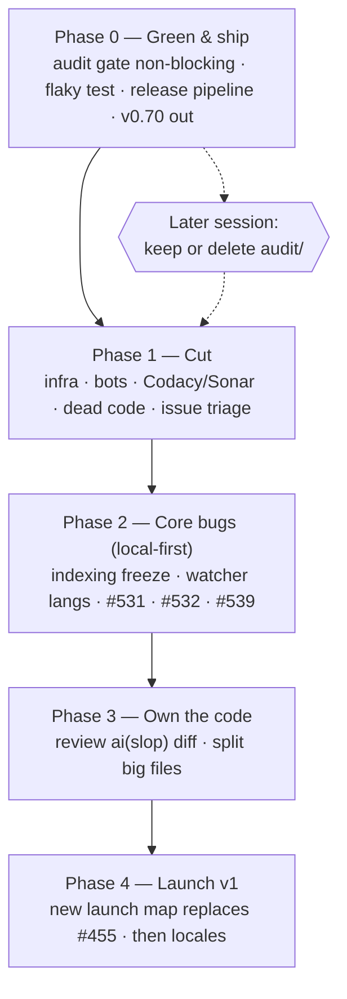

# Aperio Reset — green, lean, shipped

> Written 2026-10-22, after a 7-week pause (last feature work 2026-08-31).
> Source: full-repo audit of the same day + two grilling rounds with the developer.
> Companion tests: `trash/plans/aperio-reset/aperio-reset-tests.md`.

## Objective

Get Aperio back to a state one person can maintain and ship: CI green, a working release
pipeline, side-projects cut, core bugs fixed — so a public v1 (for non-coders **and** devs,
local models first) can launch from a known-good base.

## Decisions locked (2026-10-22 — do not re-ask)

| Topic | Decision |
|---|---|
| Purpose | Public product + portfolio piece. Personal daily use comes along for free. |
| Core features kept | Memory + chat (web UI), docgraph + doc intelligence, codegraph, terminal chat + MCP for other agents. |
| Database | Keep **both** SQLite and Postgres (devs are a target audience). |
| Providers | Keep all 6. **Focus is local models (llama.cpp).** Cloud providers get attention in later releases. |
| Locales | Keep all 26 and keep issues #421/#422. No new i18n work until the cleanup is done. |
| Continuous-audit program | Must **not block** anything now. Keep or delete is decided in a later session. |
| Cut | `k8s/`, `vms/`, aperio.live deploy, bot/gamification workflows, Codacy + Sonar. |
| Quality metrics | Keep some proof of quality: Codecov + CodeQL + npm-audit gate stay. |
| Old crossed-out epics | Not needed, may be revisited. Close as *not planned* (reopenable). |
| Pace | Full-time for some weeks, but in small shippable steps (one PR / one push each). |

## Audit snapshot (2026-10-22, master @ e44648d1)

- Unit tests: 2900/2900 green locally.
- **No release since v0.68.0 (2026-07-22).** Tags `v0.69.0`, `v0.69.1` exist with no GitHub
  release; the packaging job was skipped. The 1 September launch did not ship.
- Release trigger reads only the **head** commit message of a push, so a `fix:` followed
  by a `chore:` in one push never releases (happened 2026-10-17).
- CI red: `continuous-audit gates` (#569) since 2026-10-16; `install matrix` macOS fails
  on flaky `createMetricsSampler › never runs overlapping samples`.
- Size: ~87k lines app, ~103k lines tests, 14.5k lines `audit/` (ledger has 0 runs),
  29 workflows, 84 npm scripts, 41 deps, ~120 config keys.
- 20 `ai(slop)` commits: 284 files, +15,990 / −3,487 lines landed without review.
- Master ruleset requires only `GitGuardian Security Checks` + `code_quality` — removing
  Sonar/Codacy breaks no required check.

## Diagram

## Model recommendation

| Work | Model | Why |
|---|---|---|
| Release pipeline (S0.3), security-adjacent fixes (S2.1, S1.4) | Claude Opus | Multi-file CI + security reasoning; mistakes here cost a release or a leak. |
| Deletions, issue triage, workflow removal (Phase 1) | Claude Sonnet or local Qwen2.5-Coder-7B | Mechanical; the tests file is the safety net. |
| Concurrency bugs (S2.2, S2.4) | Claude Opus | Event-loop and race reasoning. |
| Code review of `ai(slop)` diff (S3.1) | Claude Opus + developer | Judgment work; the developer must end up owning the code. |

Estimate for the whole plan: ~3–5M input / ~300k output tokens, mostly cached reads.
Roughly $15–40 on Opus; much less if Phase 1 runs on Sonnet/local.

## Steps

Each step = one push. Tests are in the companion file under the same step ID.

### Phase 0 — Green & ship

**S0.1 Audit gate stops blocking.**
Change `.github/workflows/ci.audit.yml` triggers to `workflow_dispatch` only (keep the file).
Do **not** fix #569 by editing `lib/config.js` yet — that file is a No-Touch Zone; ask first.
*Works when:* a push to master runs no audit job, and `npm run test:audit` still runs locally.
Tests: T0.1.

**S0.2 Fix the flaky metrics-sampler test.**
`tests/unit/helpers/metricsSampler.test.js` "never runs overlapping samples" depends on
wall-clock timing. Make it deterministic (fake timers / injected clock), do not loosen it.
*Works when:* the test passes 50/50 runs locally and on the next macOS install-matrix run.
Tests: T0.2.

**S0.3 Fix the release pipeline.**
1. Find the root cause of the skipped `package-source` job for v0.69.0/v0.69.1 (the
   v0.69.1 run failed at `git push` — check the `master-rules` ruleset's `pull_request`
   rule against the bot push). Prove the cause from logs before changing anything.
2. Compute the bump from **all commits since the last tag**, not only the head commit.
3. Add a manual `workflow_dispatch` path that packages an existing tag.
*Works when:* a push of `fix: x` then `chore: y` produces a patch release; a dispatch on
an existing tag produces a release with `aperio-lite.zip` attached.
Tests: T0.3.

**S0.4 Ship v0.70.x.**
Cut the first release since July from the green master.
*Works when:* the GitHub release has `aperio-lite.zip`, the zip boots on macOS via the
lite smoke workflow, and `install.sh` clones the matching `release` branch commit.
Tests: T0.4.

### Phase 1 — Cut

**S1.1 Remove infra.** Delete `k8s/`, `vms/`, `.github/workflows/cd.k3s-deploy.yml`, and
aperio.live references in docs. Close #239, #240, #241 as *not planned*.
*Works when:* `grep -rn "k3s\|aperio.live" --exclude-dir=node_modules --exclude-dir=trash`
finds nothing live, and all remaining workflows still parse.
Tests: T1.1.

**S1.2 Remove bot/gamification workflows.** Delete `bot.issue-claim-guard.yml`,
`bot.stale-claims.yml`, `community.update-leaderboard.yml`,
`community.contributor-agreement.yml`, `bot.issue-moderation.yml`, and
`.github/workflows/obsolete/`. Check `bot.nuke.yml` and `bot.pin-shas-to-actions.yml`
with the developer first (the second may still be useful). Remove XP / robin-hood labels.
*Works when:* no workflow references a removed script; CONTRIBUTING.md no longer
describes claims or XP.
Tests: T1.2.

**S1.3 Drop Codacy + Sonar.** Delete `ci.codacy.yml`, `ci.sonarqube.yml`, their config
files and README badges. Keep Codecov, CodeQL, npm-audit.
*Works when:* README badges all resolve; required checks (`GitGuardian`, `code_quality`)
are unaffected.
Tests: T1.3.

**S1.4 Dead code.** Delete the unused sub-agent spawn path (`lib/agent/spawn.js`, #319) —
this also removes the latent agent-permission gap (F-R3-04) at its root. Leave
`plan_created` / `plan_step` / `plan_drift` events (#320) until the planning-UX epic #498
is decided (question for the developer, see Risks).
*Works when:* full test suite green; `grep -rn "spawnChild\|spawnParallel" lib mcp` = 0.
Tests: T1.4.

**S1.5 Issue triage.** Close #335, #202, #105 as *not planned*. Close map #455 (date
passed) with a comment pointing to Phase 4. Remove the blanket `muted` label from the
issues that stay open, so the tracker shows real priorities again.
*Works when:* every open issue is either in this plan or explicitly parked.
Tests: T1.5.

### Phase 2 — Core bugs (local-model first)

**S2.1 Indexing must not freeze the server.** Move codegraph/docgraph extraction off the
main thread (worker) or yield between files. Measure first: time `/api/version` during a
big index run before and after.
*Works when:* `/api/version` answers < 200 ms while indexing a large repo.
Tests: T2.1.

**S2.2 Codegraph watcher indexes every supported language.** One shared predicate for
`watcher.js isIndexable()` and `indexer.js pickExtractor()`.
*Works when:* saving a `.cs`/`.py`/`.go` file updates the graph without restart.
Tests: T2.2.

**S2.3 Settings overlay timeout.** `public/scripts/settings-overlay.js load()` gets an
abort timeout and a "server is busy" message.
*Works when:* a hung `/api/config/schema` shows the busy message within the timeout.
Tests: T2.3.

**S2.4 Docgraph → memory bridge races (#532).** Tests: T2.4.

**S2.5 Privacy redact mode (#531).** Either wire `restore()` into the reply path or remove
the `redact` mode until cloud providers are in focus. Recommend: wire it (small, and it is a
user-visible bug). Tests: T2.5.

**S2.6 Terminal parity (#539) + a real test seam for `runStandalone`** (injectable
stdin/stdout/agent). Tests: T2.6.

### Phase 3 — Own the code

**S3.1 Review the `ai(slop)` commits.** List all 20 with diffstat; review in batches with
the developer; delete what is unused, test what stays. Log leftovers to tech-debt.md.
*Works when:* every file touched by those commits is either reviewed or deleted.
Tests: T3.1.

**S3.2 Split the biggest hand-written files** where cohesive: `db/sqlite/store.js` (1589),
`db/postgres/store.js` (1395), `lib/agent/index.js` (1103). Only safe, local splits.
Tests: T3.2.

### Phase 4 — Launch v1

**S4.1 New launch map.** Re-check the #455 decisions (most should still hold), pick a new
date, open a fresh map. Local models lead the story.
**S4.2 Locales.** Resume #421/#422 only after S4.1 is set.
Tests: T4.1.

## Risks

| Risk | Mitigation |
|---|---|
| Release fix creates duplicate or wrong tags. | Test on a fork or with `workflow_dispatch` + dry-run flag first; never `--force` a tag that has a release. |
| Ruleset blocks the bot push (likely S0.3 root cause). | Prove it from logs; fix with a ruleset bypass for the release actor, not by dropping protection. |
| Deleting a workflow that a doc, badge, or script still references. | T1.x greps for every removed filename before the push. |
| Removing `spawn.js` kills a planned feature. | **Open question:** is sub-agent spawn on the roadmap? If yes, keep it and wire enforcement instead. |
| `#320` plan events tie into #498. | Keep them until #498 is decided. |
| #569 fix needs `lib/config.js` (No-Touch Zone). | Ask before editing; run `npm run gen:env` + `gen:env:check`. |
| Scope creep inside "small steps". | One step = one push. Anything new goes to A2D.md, not into the current step. |

## Doc updates

- `README.md` — badges (S1.3), infra mentions (S1.1).
- `CONTRIBUTING.md` — claims/XP text (S1.2).
- `FEATURES.md` — remove spawn / aperio.live mentions (S1.1, S1.4).
- `id/reference/ci-cd.md` — workflow list + release flow (S0.1, S0.3, S1.x).
- `id/reference/tech-debt.md` — delete entries as they are fixed (S2.x, F-R3-04 after S1.4).
- `CHANGELOG.md` — `## Unreleased` entry per step.
- `SECURITY.md` — only if S2.5 changes redact-mode behaviour.
