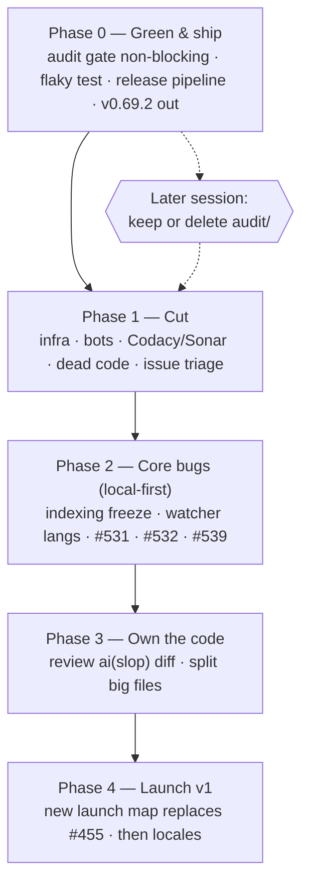

# Aperio Reset — green, lean, shipped

> Written 2026-10-22, after a 7-week pause (last feature work 2026-08-31).
> Source: full-repo audit of the same day + two grilling rounds with the developer.
> Companion tests: `trash/plans/aperio-reset/aperio-reset-tests.md`.

## Objective

Get Aperio back to a state one person can maintain and ship: CI green, a working release
pipeline, side-projects cut, core bugs fixed — so a public v1 (for non-coders **and** devs,
local models first) can launch from a known-good base.

## Decisions locked (2026-10-22 — do not re-ask)

| Topic | Decision |
|---|---|
| Purpose | Public product + portfolio piece. Personal daily use comes along for free. |
| Core features kept | Memory + chat (web UI), docgraph + doc intelligence, codegraph, terminal chat + MCP for other agents. |
| Database | Keep **both** SQLite and Postgres (devs are a target audience). |
| Providers | Keep all 6. **Focus is local models (llama.cpp).** Cloud providers get attention in later releases. |
| Locales | Keep all 26 and keep issues #421/#422. No new i18n work until the cleanup is done. |
| Continuous-audit program | Must **not block** anything now. Keep or delete is decided in a later session. |
| Cut | Bot/gamification workflows, Codacy + Sonar. |
| Infra on master (2026-10-22, revised) | **`k8s/`, `vms/` and `cd.k3s-deploy.yml` STAY on `master`.** `release` becomes the official installation branch and is stripped there; future contributors branch from `master`, where this infra is still useful. The aperio.live *deploy* stays cut as a goal — nothing is deployed — but the files are not deleted. This retires step S1.1. |
| Quality metrics | Keep some proof of quality: Codecov + CodeQL + npm-audit gate stay. **S1.3 found CodeQL was itself `disabled_manually` since 2026-07-05 — re-enabled 2026-10-22.** Of the four README quality badges, three were rendering frozen July data. |
| Old crossed-out epics | Not needed, may be revisited. Close as *not planned* (reopenable). |
| Deleted work | Nothing is lost: an annotated tag `archive/pre-reset-2026-10-22` is pushed before Phase 1, and closed issues stay reopenable. Recover with `git checkout archive/pre-reset-2026-10-22 -- <path>`. |
| Pace | Full-time for some weeks, but in small shippable steps (one PR / one push each). |
| Version numbers (2026-10-22, after S0.4) | **S0.4 shipped v0.69.2, not v0.70.x.** The bump is computed from the commits since the last tag, and the range held 11 `fix:` commits and zero `feat:` — so SemVer says patch, and the plan's round number was never earned. **v0.70.0 is reserved for the Phase 4 launch (S4.1)**, to be carried by a real `feat:`. Do not spend it on a cleanup step. |

## Audit snapshot (2026-10-22, master @ e44648d1)

- Unit tests: 2900/2900 green locally.
- **No release since v0.68.0 (2026-07-22).** Tags `v0.69.0`, `v0.69.1` exist with no GitHub
  release; the packaging job was skipped. The 1 September launch did not ship.
- Release trigger reads only the **head** commit message of a push, so a `fix:` followed
  by a `chore:` in one push never releases (happened 2026-10-17).
- CI red: `continuous-audit gates` (#569) since 2026-10-16; `install matrix` macOS fails
  on flaky `createMetricsSampler › never runs overlapping samples`.
- Size: ~87k lines app, ~103k lines tests, 14.5k lines `audit/` (ledger has 0 runs),
  29 workflows, 84 npm scripts, 41 deps, ~120 config keys.
- 20 `ai(slop)` commits: 284 files, +15,990 / −3,487 lines landed without review.
- Master ruleset requires only `GitGuardian Security Checks` + `code_quality` — removing
  Sonar/Codacy breaks no required check.

## Diagram

## Model recommendation

| Work | Model | Why |
|---|---|---|
| Release pipeline (S0.3), security-adjacent fixes (S2.1, S1.4) | Claude Opus | Multi-file CI + security reasoning; mistakes here cost a release or a leak. |
| Deletions, issue triage, workflow removal (Phase 1) | Claude Sonnet or local Qwen2.5-Coder-7B | Mechanical; the tests file is the safety net. |
| Concurrency bugs (S2.2, S2.4) | Claude Opus | Event-loop and race reasoning. |
| Code review of `ai(slop)` diff (S3.1) | Claude Opus + developer | Judgment work; the developer must end up owning the code. |

Estimate for the whole plan: ~3–5M input / ~300k output tokens, mostly cached reads.
Roughly $15–40 on Opus; much less if Phase 1 runs on Sonnet/local.

## Steps

Each step = one push. Tests are in the companion file under the same step ID.

### Phase 0 — Green & ship

**S0.1 Audit gate stops blocking.**
Change `.github/workflows/ci.audit.yml` triggers to `workflow_dispatch` only (keep the file).
Do **not** fix #569 by editing `lib/config.js` yet — that file is a No-Touch Zone; ask first.
*Works when:* a push to master runs no audit job, and `npm run test:audit` still runs locally.
Tests: T0.1.

**S0.2 Fix the flaky metrics-sampler test.**
`tests/unit/helpers/metricsSampler.test.js` "never runs overlapping samples" depends on
wall-clock timing. Make it deterministic (fake timers / injected clock), do not loosen it.
*Works when:* the test passes 50/50 runs locally and on the next macOS install-matrix run.
Tests: T0.2.

**S0.3 Fix the release pipeline.**
1. Find the root cause of the skipped `package-source` job for v0.69.0/v0.69.1 (the
   v0.69.1 run failed at `git push` — check the `master-rules` ruleset's `pull_request`
   rule against the bot push). Prove the cause from logs before changing anything.
2. Compute the bump from **all commits since the last tag**, not only the head commit.
3. Add a manual `workflow_dispatch` path that packages an existing tag.
*Works when:* a push of `fix: x` then `chore: y` produces a patch release; a dispatch on
an existing tag produces a release with `aperio-lite.zip` attached.
Tests: T0.3.

**S0.4 Ship the first release since July.** — **DONE 2026-10-22: v0.69.2.**
Cut from the green master. The number is **v0.69.2**, not v0.70.x: the S0.3 bump logic read
37 commits since v0.69.1 and counted 11 `fix:` with no `feat:`, so patch is the honest
answer. v0.70.0 is reserved for S4.1 — see the Decisions-locked table.
*Worked:* release v0.69.2 published with `aperio-lite.zip` (6.44 MB, against the 5.1 MB
v0.68.0 baseline); lite smoke green on the tag across all five runners
(`gh workflow run ci.lite-smoke.yml --ref v0.69.2`, run `39820710035`); `origin/release`
== the tag's commit `52778b7b`, the first time that branch has moved off v0.68.0.
Also backfilled by hand: **v0.69.1 now has a release** (dispatch run `39819904949`, which
wrote no commit, tag or branch — the mode=package path doing its job). **v0.69.0 stays a
bare tag** by decision: two releases superseded it within days.
Tests: T0.4 — all checks pass.

### Phase 1 — Cut

**S1.0 Archive tag (do this first).** Before any delete, create and push an annotated tag
on the current green master so every cut file keeps one named, permanent address:
`git tag -a archive/pre-reset-2026-10-22 -m "state before the Aperio Reset cut"` then
`git push origin archive/pre-reset-2026-10-22`. Recovery for any path afterwards is
`git checkout archive/pre-reset-2026-10-22 -- <path>`.
*Works when:* the tag is visible on GitHub and a test checkout of `k8s/` from it succeeds.
Tests: T1.0.

**S1.1 Remove infra.** — **DROPPED 2026-10-22 by developer decision. Do not re-plan it.**
Nothing is deleted. Reason: `master` is the branch future contributors fork from, and the
stripping happens on `release`, which becomes the official installation branch. Deleting the
files on `master` would be work undone later.

Two findings from the aborted consumer sweep are kept because they outlive the step:

1. **`vms/` is not optional infra — it is load-bearing CI.** Three live workflows execute
   files inside it: `ci.install-matrix.yml` (`vms/smoke.sh`, `vms/smoke.ps1`, trigger
   `vms/**`), `ci.lite-smoke.yml` (`vms/smoke.sh`, `vms/smoke.ps1` — the workflow that
   verified v0.69.2) and `ci.docker-smoke.yml` (`vms/docker/run.sh`, trigger
   `vms/docker/**`). `tests/integration/vms/` is therefore **shared, not Vagrant-only**:
   `smoke-contract.test.js` (6), `ci-workflows.test.js` (5) and `docker-executor.test.js`
   (5) pin the CI contract; only `vagrant-executor.test.js` (3), `mac-executor.test.js` (5)
   and `windows-executor.test.js` (3) are local-VM-only. **Any later strip of `vms/` on
   `release` must keep `smoke.sh`, `smoke.ps1` and `docker/run.sh`, or three workflows and
   the release verification path go red.**
2. **`APERIO_PI_WEBHOOK_URL` / `APERIO_PI_WEBHOOK_SECRET` are already dead secrets.** The
   only reader is the *commented-out* "Notify Pi" step in `cd.k3s-deploy.yml`. They can be
   deleted by hand at any time (GitHub → Settings → Secrets and variables → Actions)
   without touching code. Not an action item for this plan.

`k8s/` consumers, for whoever does the `release` strip: `cd.k3s-deploy.yml` (trigger
`k8s/**`, header points at `k8s/aperio-webhook.service`), `id/reference/ci-cd.md:109-115`,
`SECURITY.md:208,220`, `docker/Dockerfile:39` (comment), `docs/guides/k8s.html` + its nav
link in `docs/index.html:81`, and `CHANGELOG.md` (history, keep). The `k8s` hits in
`lib/agent/index.js:160`, `lib/routes/api-meta.js:351` and `lib/helpers/selfRestart.js:9`
are the generic word for a supervisor, not deploy code — never touch those.

`lite-zip-decouple` is unaffected: its `k8s/*` and `vms/*` exclude-list entries all still
apply, because nothing was deleted.

**#239, #240, #241 (aperio.live epic) move to S1.5**, where the rest of the issue triage
lives. They are still closed as *not planned* — the deploy goal is cut even though the
files stay.
*Works when:* n/a — retired step.
Tests: T1.1 retired.

**S1.2 Retire the bot/gamification workflows.** — **DONE 2026-10-22.**
**Revised 2026-10-22: park, do not delete.** The developer chose to keep every file so the
work behind it is not lost. `.github/workflows/obsolete/` is therefore **not** deleted — it
becomes the standing parking lot, and `obsolete/` is where retired workflows live from now
on. GitHub Actions scans only `.github/workflows/*.yml`, never a subdirectory, so a parked
file cannot run.

Moved into `.github/workflows/obsolete/`, each with its `on:` block stripped to
`workflow_dispatch:` plus a PARKED banner, so it stays inert even if the file is moved back
up by accident: `bot.issue-claim-guard.yml`, `bot.stale-claims.yml`,
`bot.issue-moderation.yml`, `community.contributor-agreement.yml`,
`community.update-leaderboard.yml`.

**Kept active:** `bot.nuke.yml` and `bot.pin-shas-to-actions.yml`. The first is
dispatch-only and dry-run by default, and shares `.github/scripts/nuke.cjs` +
`.github/data/blocklist.json` with `ci.pr-guard.yml`, which stays. The second is a real
supply-chain guard that pins third-party action SHAs on every PR touching
`.github/workflows/**` — gamification it is not.

**Labels: none deleted, by developer decision.** `robin-hood` (1 open / 29 closed),
`🛡️ 100xp` (1 / 20), `🛡️ 50xp` (0 / 4), `🛡️ 25xp` (0 / 4), `🛡️ 75xp` (0 / 2) and
`status: claimed` (0 / 6) all stay. Deleting a label strips it from 65 closed issues and
that is irreversible. The blanket `muted` label on open issues is still S1.5's business.

**Data files kept, now unread by any active workflow:** `.github/data/seniority-tiers.json`
(claim-guard tiers, its only reader was the claim guard) and `.github/LEADERBOARD.md` (the
standings the leaderboard job wrote).

**Nothing shared was removed.** All five parked workflows ran inline
`actions/github-script`; no `.github/scripts/` file became dead. `cd.release.yml` builds
`launchers/` itself (lines 91, 300, 322) and never called the parked
`obsolete/cd.aperio-lite-launchers.yml`.

**Two plan expectations that did not hold:** `CONTRIBUTING.md` has no XP or leaderboard
text — only line 18 links to a *Payment & Bounty Policy* GitHub Discussion, left untouched
because it lives outside the repo and the developer deleted nothing. `README.md` is clean.
`FEATURES.md:139` says "claim" about the interrupt service; unrelated, kept.
*Worked:* no active workflow names a parked file; `actionlint .github/workflows/*.yml`
reports only the pre-existing shellcheck info/warnings; `npm run test:unit` green.
Tests: T1.2 — pass.

**S1.3 Retire Codacy + Sonar, revive CodeQL.** — **DONE 2026-10-22.**
**Revised: park, do not delete** — same treatment as S1.2. `ci.codacy.yml` and
`ci.sonarqube.yml` moved to `.github/workflows/obsolete/` with their `on:` blocks stripped
to `workflow_dispatch:` and a PARKED banner. **There were no config files to delete** —
both tools were configured entirely inside their workflow YAML (`-Dsonar.*` args inline for
Sonar, the action's own defaults for Codacy). Nothing in `lib/`, `db/`, `mcp/` or `tests/`
references either tool; the one `grep` hit in `tests/e2e/helpers/test-agent.js` is `jsonArgs`
matching "sonAr".

**The step's premise was wrong, and the real finding is bigger.** Both tools were already
`disabled_manually` on GitHub and neither had run since **2026-07-05**. Codacy had **never
passed**: 0 successes in its last 100 runs (62 failures, 38 cancelled). Sonar was 100/100
green but three and a half months stale. So the step won **zero CI minutes**. What it
actually won was two README badges that had stopped telling the truth. And the same sweep
found **`ci.codeql.yml` was `disabled_manually` too** — the gate this plan's
Decisions-locked table says to keep. It was **re-enabled 2026-10-22**. Note it has no
`push` trigger (PRs to `master`, Sunday 08:17 UTC, or dispatch), so a direct commit to
`master` never refreshes its badge.

**Required checks were never at risk.** `master-rules` requires exactly one context:
`GitGuardian Security Checks`. The plan's claim that `code_quality` is also required is
**out of date** — it is not in the ruleset.

**Docs edited:** README badges for Sonar and Codacy removed (a parked workflow can never
refresh them); `SECURITY.md` monitoring table lost both rows and now honestly says *three*
layers, not two; `FEATURES.md` CI line drops SonarCloud + Codacy; `id/reference/ci-cd.md`
gains a **Disabled on GitHub** section, because a workflow switched off in the Actions UI
looks live in the tree and no `grep` can reveal it.

**Report-only — three dead repository secrets to delete by hand:**
`CODACY_PROJECT_TOKEN`, `SONAR_TOKEN`, `SONAR_HOST_URL`.
*Worked:* `actionlint` clean bar pre-existing notes; `ci.codeql.yml` reports `active`;
no doc or workflow names either parked file outside the parked section.
Tests: T1.3 — pass.

**S1.4 Dead code.** **Deferred by developer decision (2026-10-22).** `lib/agent/spawn.js`
(#319) is live product code, not CI clutter, and the planning-UX epic #498 is still
undecided — the same reason this step already gives for leaving `plan_created` /
`plan_step` / `plan_drift` (#320) alone. Keep both until #498 is decided, then revisit
in one step. The latent agent-permission gap (F-R3-04) therefore stays open; it is
tracked in `id/reference/tech-debt.md` and must not be closed by this plan.
*Works when:* #319 and #320 carry a comment pointing at #498; no code is removed here.
Tests: T1.4.

**S1.5 Issue triage.** — **DONE 2026-10-22.** First pass closed #239, #240, #241 as
*not planned* (moved here from the dropped S1.1), each with a comment recording that the
aperio.live deploy is cut, that `k8s/` and `cd.k3s-deploy.yml` nonetheless stay on `master`,
where the plans live (`trash/plans/aperio-live/`), and that the pre-cut tree is tagged
`archive/pre-reset-2026-10-22`. Second pass closed #335, #202, #105 as *not planned* (all
three already had struck-through titles and sit outside the locked core) and closed map #455,
whose 1 September date had passed and whose 13 tickets were all resolved — its comment hands
launch planning to Phase 4 and records that v0.70.0 is reserved for S4.1. All seven are
reopenable.
The blanket `muted` label was the real finding: it sat on **all 26** open issues, so it
carried no signal at all. It is now removed from every one of the 22 that stay open; the
label itself is not deleted. Of those 22 the plan names only nine (#319, #320, #421, #422,
#498, #531, #532, #539, #569), so the other thirteen were given a note rather than left
ambiguous — #250 and #251 marked in-scope (doc intelligence is a locked kept feature, next
action WS4 / T-G6), and #187, #321, #338, #355, #356, #357, #358, #359, #361, #476, #528
parked until after Phase 4. #355–#359 and #321 are one family (the multi-turn harness); #361
is the spec map behind the still-undecided #498, so it parks for the same reason S1.4 gives.
*Worked:* 22 open issues, zero carrying `muted`, every one named in this plan or carrying a
parked/in-scope note.
Tests: T1.5.

### Phase 2 — Core bugs (local-model first)

**S2.1 Indexing must not freeze the server.** — **DONE 2026-10-22.**
Move codegraph/docgraph extraction off the main thread (worker) or yield between files.
Measure first: time `/api/version` during a big index run before and after.

**The step's "or" was wrong — both halves were needed.** `await readFile` between files
already yields, so a pass over ordinary source never froze anything: the baseline there was
p95 25 ms, comfortably inside the target. The freeze lived *inside* one file, in two places
the plan did not name. Extraction is one of them and a worker fixes it, because
`parser.parse(source)` is a single atomic WASM call that cannot be sliced (204 ms for an
0.8 MB file, linear in size). The other is the write loop: one bundle-shaped file is ~32k
synchronous better-sqlite3 statements, ~2.2 s with no yield point in it. A worker alone
would have left that.

**What shipped.** Extraction runs on a worker thread for both graphs
(`lib/codegraph/extract-worker.js`, `lib/docgraph/extract-worker.js`, pooled by
`lib/helpers/extractorPool.js` with a closed key registry, lazy spawn, idle terminate and
automatic in-process fallback). The SQLite write loops yield through
`lib/helpers/timeSlice.js`. The codegraph edge resolver, previously one statement over every
edge in the repo (365 ms on a 175k-edge graph, unsliceable), is batched by edge id.
**Postgres needed no change** — every statement there is an awaited round trip, so it already
yields; its extraction benefits for free from the indexer-level swap. `lib/config.js` was
not touched: the five tunables are module constants and are logged in `A2D.md`.

**Measured, isolated scratch instance** (scratch DB, port 48731, scratch cwd), `/api/version`
during a full pass, p95 / p99 / worst:

| corpus | before | after |
|---|---|---|
| 804 ordinary source files | 25 / 46 / 55 ms | 9 / 13 / 96 ms |
| the same plus six bundle-shaped files | 29 / 2700 / 3012 ms | 8 / 27 / 138 ms |
| 189 documents, one of them 13 MB | — / 1225 / 1248 ms | 11 / 14 / 18 ms |

**p95 hid the bug, and that is the lesson.** The code corpus *passed* at p95 while the
server went unanswered for three seconds at a time. The document corpus is the one that
failed the gate outright (p95 294 ms on the first run). Its baseline p95 is left blank above
rather than guessed: the pass blocked so hard that the prober landed 69 of ~250 samples, and
a p95 over that few samples is noise. Any future freeze claim in this repo should carry
worst-case next to p95.

**Two latent bugs found by measuring, both of the "succeeds while silently wrong" kind:**
1. Smallest-enclosing-symbol lookup in **both** code extractors was O(symbols × call sites)
   — 511 ms of a 613 ms extraction on a file with 8k functions, and quadratic: 16k functions
   took 1.7 s, now 0.7 s. The two extractors carried the same scan verbatim; they now share
   `lib/codegraph/owner-index.js`. A differential run against the old implementation caught
   that its tie-break was *positional*, which a sorted backward scan flips.
2. **A Buffer does not survive structured clone as a Buffer.** It arrives as a plain
   Uint8Array, whose `toString('utf8')` returns `"104,101,108,…"`. Every docgraph extractor
   does exactly that call, so the first worker run indexed the whole corpus "successfully"
   while collapsing 2670 sections into 189. Only the result-identity check saw it.

*Worked:* p95 during indexing 8–11 ms across all three corpora, zero samples over 200 ms,
against a 200 ms target. Indexing results **byte-for-byte identical** before and after — same
files, symbols, edges, resolved edges, documents, sections, chunks — and total index time
unchanged (±3%). `npm run test:unit` 2942/2942 (2900 + 42 new), `npm run test:harness` 33/33,
`test:integration` 2744/2744, `test:docint` 111/111, `test:e2e` 113/113. Both new regression
tests were run against a pristine `HEAD` checkout and **fail** there, while the
result-identity test passes on both sides — which is what proves nothing was lost. Teardown
left nothing in the repo tree.
Tests: T2.1 — pass.

**S2.2 Codegraph watcher indexes every supported language.** — **DONE 2026-10-22.**
One shared predicate for `watcher.js isIndexable()` and `indexer.js pickExtractor()`.

**The bug was wider than this line said, and it was two bugs, not one.**
1. **The language gap.** `pickExtractor()` accepted `JS_EXT` *plus* `extract-generic.js`'s
   25 `SUPPORTED_EXTS` (`bash c cc cpp cs cxx gemspec go h hh hpp hxx java kt kts php phtml
   py pyi rake rb rs sh swift zsh`). `watcher.js isIndexable()` checked `JS_EXT` and nothing
   else. So the initial `indexRepo` pass *did* index all 25 and every live save to 25 of
   them was then dropped in silence — a C# or Python repo indexed once on startup and went
   stale forever with no error anywhere. The chokidar `ignored` option did **not** have this
   half of the gap; it never filtered by extension at all.
2. **The absolute-path `SKIP_DIRS` split** (second asymmetry, folded into this step by
   developer decision rather than given its own step: it is the same two call sites in the
   same function, the fix was already proven in docgraph, and the T2.2 test could not
   otherwise exercise a real temp root). Both `isIndexable()` and the chokidar `ignored`
   split the **absolute** path and rejected any segment in `SKIP_DIRS`, so a root under
   `build/`, `bin/`, `out/`, `var/` or `trash/` — e.g. `/Users/me/build/myproject`, or any
   macOS temp dir, which resolves under `/private/var/folders/...` — had every file
   rejected. docgraph scoped the same check to the path *relative* to the root on
   2026-08-21; codegraph never got that fix.

**What shipped.** `pickExtractor()` is now exported from `lib/codegraph/indexer.js` and is
the single authority on indexability — `walk()`, `indexFile()` and the watcher's
`isIndexable()` all route through that one call, so extension support is no longer decided
in the watcher at all. `JS_EXT` stopped being exported, because exporting it is exactly how
the two predicates drifted apart. `lib/codegraph/watcher.js` gained `hasSkippedSegment(root,
abs)` and `isIndexable(root, abs)` copied from the docgraph shape, and the chokidar
`ignored` option uses the same `hasSkippedSegment`. **docgraph was not touched** — no defect
was found in it; it is the model, as instructed. `lib/config.js` was not touched.

**Grep proof of the one shared predicate** (asked for explicitly, not asserted): every
`pickExtractor` call site in `lib/codegraph/` is `indexer.js:56` (the definition),
`indexer.js:102` (`walk`), `indexer.js:140` (`indexFile`) and `watcher.js:95`
(`isIndexable`). There is no other extension test anywhere in the directory.

*Worked:* a real chokidar watcher over a real tree with a real better-sqlite3 database
behind it — add, change and unlink on `.js`, `.cs`, `.py` and `.go` each update `cg_symbols`
within the debounce window with no restart; an unsupported `.txt` produces no event and no
rows. Green in **both** watch modes (native and the polling fallback —
`APERIO_TEST_WATCH_POLLING=1` forces polling, since a pass that only works under native fs
events is not a pass). `npm run test:unit` 2984/2984 (2942 + 42 new),
`npm run test:harness` 33/33, `npm run test:integration` 2750/2750 (2744 + 6 new).

**The regression test was verified red against a pristine `git archive HEAD` tree**, and the
two bugs were separated there rather than proven as one blur: under a macOS temp root
(`/private/var/...`) **5 of 6** tests failed, because bug 2 rejects every file including the
`.js` one; re-run with `TMPDIR` pointed at a path containing no skip-dir segment, **exactly**
`.cs`, `.py` and `.go` failed and `.js` passed — which is bug 1 alone, with no help from bug
2. The unit tests also go red on `HEAD`, but only as an import error for the new exports,
which is a weak red; the integration test carries the real proof. Teardown left nothing in
the repo tree.
*Works when:* saving a `.cs`/`.py`/`.go` file updates the graph without restart.
Tests: T2.2 — pass.

**S2.3 Settings overlay timeout.** — **DONE 2026-10-22.**
`public/scripts/settings-overlay.js` `load()` gets an abort deadline and a distinct
"server is busy" message.

**What shipped.** `load()` now creates an `AbortController`, passes its signal to
`fetch("/api/config/schema")` and arms a `LOAD_TIMEOUT_MS = 8000` deadline that aborts
it. The controller is kept in a module-level `loadAbort`, so the close branch of
`toggleSettingsOverlay()` cancels an in-flight request and a second `load()` supersedes
the first instead of racing it. The timer is cleared in a `finally` on every path.

**"Busy" is a third state, not a re-use of the failure string.** A new locale key
`stov_load_busy` ("Server is busy — configuration did not load in time") sits beside the
existing `stov_load_failed`; a rejected fetch still reads "Failed to load configuration".
A cancel that is *not* the deadline (panel closed, or superseded) paints nothing at all —
a user-initiated close is not an error.

**The save path was checked, not assumed.** `saveAll()` calls `await load()` at line 474
with `stovSaveBtn` already disabled. `load()` swallows its own failure rather than
throwing, so `saveAll()`'s `finally` still re-enables the button — a timed-out re-read
cannot leave the save button dead.

**Timeout value.** Module constant, by developer decision — the S2.1 precedent. Not a
`lib/config.js` key, so that No-Touch Zone and `gen:env` were not touched. Logged to
`A2D.md` as a candidate config key if a user ever needs to raise it.

**Reported, deliberately not fixed (out of scope).** The `PUT /api/settings/...` writes in
`saveAll()` (line 462) are also un-timed, so a wedged server hangs a save the same way —
worth its own step. The `restartAperio()` ping at line 549 is un-timed **by design**: the
connection is expected to drop and the 90 s deadline loop is the real guard there.
*Works when:* a hung `/api/config/schema` shows the busy message within the timeout.
Tests: T2.3 — pass.

**S2.4 Docgraph → memory bridge races (#532).** — **DONE 2026-10-24.**

**Bug 1 — `documentExists()` now takes the repo-row lock.** On Postgres it read with two
plain autocommit queries, so under READ COMMITTED an uncommitted deletion was invisible and
a check landing in that window answered `true` on a row already being deleted — the bridge
memory was then written after that deletion's purge had run, orphaned for good. It now runs
`BEGIN` → `SELECT … FROM docgraph_repos WHERE root_path=$1 FOR UPDATE` → the existence read
→ `COMMIT`, the same lock `removeOneFile`/`sweepMissingFiles`/`deleteDocumentsPage`/
`finalizeRepoDelete` already take. Public shape unchanged. **SQLite needed no change**: its
writes are synchronous `db.transaction()` calls on a single-threaded runtime, so no caller
can observe a delete mid-flight.

**Bug 2 — the sweep's delete is pinned to the version it scanned.** `sweepMissingFiles`
deleted by `rel_path`, and `upsertDocument` reuses the same row for a path, so a file
deleted, recreated and reindexed during the slow `fs.stat` scan was still matched and its
fresh bridge memory purged with it. The delete now matches `(id, indexed_at)` as captured at
scan time — Postgres via `UNNEST` + `IS NOT DISTINCT FROM` (NULL-safe, so an unstamped row
stays sweepable), SQLite via a row-value `IN` over `IFNULL(indexed_at,'')`, batched at 500
because the pin binds two parameters per candidate instead of one. Return shape
(`{ removed, relPaths }`) and callers unchanged.

**One deviation from the issue's spec, and it was necessary, not cosmetic.** The issue
assumed `indexed_at` was "bumped on every real content change, unchanged on a no-op
reindex", and pinned to it as-is. Pinning to that stamp does not hold:

1. *A file recreated with identical content.* `upsertDocument` short-circuits on a matching
   `sha256` and never restamped, so the revived row kept a stamp older than the scan, matched
   the pin, and was swept away with its memory anyway. The no-op path now restamps.
2. *Two restamps inside one clock tick.* `new Date().toISOString()` has millisecond
   resolution, so a reindex could land on the stamp already stored and keep matching the pin.
   **This was not theoretical — the end-to-end test failed on it first try.** Both backends
   now guarantee a strictly increasing stamp per row.
3. *Postgres `now()` is the transaction timestamp*, not the wall clock, so every document an
   indexing transaction touched got an identical stamp and a restamp inside that same
   transaction changed nothing at all. Replaced with `clock_timestamp()`, wrapped in
   `GREATEST(…, indexed_at + interval '1 microsecond')`.

Nothing reads `indexed_at` anywhere else in the repo (checked), so widening its meaning to
"last time we confirmed this document" is contained to these two functions.

**Not touched:** `lib/config.js` (no new key), both migration directories (no schema change),
and the un-registered-env-var audit failure below.

*Works when:* a document reindexed mid-sweep keeps its row and its memory; a promotion that
races a delete cannot write an orphan. Tests: T2.4 — pass.

**Pre-existing failure, left alone (not caused by this step).** `npm test` is 6462/6463 with
one red: `audit/tests/config-contract.test.js` reports `APERIO_MCP_AUTH_TOKEN` (`mcp/index.js`)
and `APERIO_RUNTIME_ROOT` (`lib/handlers/memory/memoryHandlers.js`) as unregistered env reads.
Both predate this work — `memoryHandlers.js` last changed in `34ef978e ai(slop)`. Registering
them means touching the `lib/config.js` No-Touch Zone plus `npm run gen:env`, which is its own
step, and `APERIO_RUNTIME_ROOT` is `ai(slop)` code that S3.1 may well delete instead.

**S2.5 Privacy redact mode (#531).** — **DONE 2026-10-24.** Not as planned: the step's own
premise was stale.

**`restore()` was already wired — the plan and issue #531 were both out of date.** The fix
landed in the unticketed `34ef978e ai(slop): can't say much - leftovers` (2026-08-31) and
shipped in **v0.69.2**; CHANGELOG.md already carries it. Nobody closed the issue, so the
plan inherited a step that was done. Same pattern as #507, where most of the work had
already landed unnoticed — **verify before assuming a blank slate.** What exists today, all
of it checked by code read rather than taken from the comments:

- `recallHandler` mints UUID-namespaced placeholders and keeps the map out of the public
  MCP result; only the private, single-use `aperio/takeRedactionMap` method redeems it.
- `lib/agent/redaction-relay.js` restores streamed tokens for every provider, including
  Codex, which bypasses `callToolHooked` and redeems on demand from the text itself.
- `lib/agent/index.js` restores `finalText`, and attaches `_redactedDisplayText` rather than
  rewriting `messages[].content` — the PRIVACY-01 invariant, so the model-facing history
  re-sent to the cloud next turn stays redacted.
- `createStreamRestorer` holds back a placeholder split across chunks.
- The on-disk map (needed because Codex's MCP child cannot share an in-memory `Map`) is
  owner-only `0700`/`0600`, under `APERIO_RUNTIME_ROOT`, with a 20-minute TTL, a writer-side
  timer, and `lib/workers/redaction-map-prune.js` as the backstop for a child that exits
  first — started in `backgroundWorkers.js`, stopped in `shutdown.js`.
- `FEATURES.md:311` already describes round-trip behaviour accurately.

Six review rounds are visible in the comments. **The mechanism needed no change.**

**So the real work was the T2.5 gaps, and one genuine bug found while checking them.**

**Bug found: `npm test` wrote PII-shaped files into the checkout.** The side-channel test
spawned its MCP child with no `APERIO_RUNTIME_ROOT`, so `memoryHandlers.js` fell back to a
path derived from its own file location — the source tree — and each recall wrote a real map
file into the repository's `var/redaction-maps/`. Only the permissions case ever redeemed
(and so deleted) its own file, so every run left a few behind; 16 had accumulated. Contents
were the test's fixture addresses, not anyone's real data, and the files were already
owner-only, but the same code path in production holds genuine PII and a test has no business
exercising it into the checkout. Both spawns now point at the scratch dir `after()` already
deletes. Verified: full `npm test`, then `ls var/redaction-maps` → 0 files. The
checkout-fallback behaviour stays covered by its own dedicated case.

**Tests added for T2.5's uncovered assertions.** T2.5 asks that the map "is not logged or
persisted beyond the turn" — it *is* persisted, by necessity, so that guarantee rests
entirely on the TTL sweep, which had no test at all:
- `tests/unit/privacy/redaction-map-sweep.test.js` (new, 6 cases) — the expiry boundary in
  both directions, every expired entry swept in one pass, a missing directory returning 0
  instead of throwing (which would kill the worker's tick), and a racing unlink not
  stranding later orphans. Sets `APERIO_RUNTIME_ROOT` *before* the dynamic import, since
  `REDACTION_MAP_DIR` is a module-level const — setting it after would have swept the
  developer's real `var/`.
- `tests/unit/workers/redaction-map-prune.test.js` (new, 5 cases) — the worker shipped with
  a `_sweep` injection seam built for a test and nothing using it, while all three sibling
  pruners were tested. Covers the start-up sweep (not just the first interval), the interval
  surviving a throwing tick, and `stop()`. Uses `t.mock.timers` rather than adding a
  test-only field to the worker.
- `tests/unit/privacy/redact.test.js` (+2 cases) — T2.5's mangled-placeholder edge: a token
  the model re-cased, letter-spaced, or stripped a guillemet from passes through untouched
  and never resolves to the real value.

*Works when:* placeholders never reach the user, the map does not outlive its TTL, and a
mangled placeholder is not mis-restored. Tests: T2.5 — pass. Suite: 6475/6476, the one red
being the pre-existing config-contract failure recorded under S2.4.

**Left for the developer:** close #531 on GitHub — it describes a state that has not been
true since August. Not closed from this session; issue hygiene is the developer's call.

**S2.6 Terminal parity (#539) + a real test seam for `runStandalone`.** — **DONE 2026-10-24.**
Scoped down, with the developer's agreement, to **#539 Phase 1 + the seam + one piece of
Phase 2**. #539 is an epic: 7 findings, 3 phases, 8 acceptance criteria. Phases 2 and 3 are
now S2.7 and S2.8 below.

**All 7 findings were checked against master first, and none had been fixed.** Unlike S2.5,
the issue was not stale — the 2026-08-30 audit at `4cb410e8` still described the code. One
finding was *understated*: it called the legacy `delete_confirm_pending` prompt "not the
current flow", when in fact **nothing in `lib/` or `mcp/` emits that event any more**, so
`cliEmitter.js:302` was unreachable and the terminal's only confirmation path was dead code.

**The P1 safety gap, closed.** `action_confirm_pending`, `interrupts` and `interrupt_decided`
had no case in `cliEmitter.js`, so a pending write/delete/database/index/template action
printed as `[event: action_confirm_pending]` — *without the token*, so even the manual
type-the-token fallback was unavailable. A terminal user could not finish the action at all.
New `lib/terminal/confirm.js` (transport-neutral: a numbered pending store, renderers, the
command parser, `planDecision`, `buildDecisionMessage`) plus `/pending`, `/approve`,
`/reject`, `/respond <text>` and `/edit <json>` in both modes.

**The two modes differ, deliberately.** Proxy mode sends the browser's own `confirm_action` /
`interrupt_decision` messages, so validation and execution stay in `api-interrupts.js`;
standalone mode redeems the token in-process via `callTool(tool, { confirmation_token })`,
which is exactly the fallback `handleConfirmAction` already uses on a 404. **Standalone gets
approve + reject only**: `edit` and `respond` go through the interrupt service, which needs a
store `createAgent()` does not return (checked: `lib/agent/index.js:773`). `planDecision`
refuses them with what *is* available rather than leaving the user typing a dead command.
Durable-interrupt *restore* likewise stays proxy-only. Rejecting a live proposal sends
nothing — the token is one-shot, so dropping it IS the rejection; a durable row behind it
comes back in the next `interrupts` replay, where `/reject` goes through the service properly.

**Two bugs found by the new unit tests, both the same root cause.** A numeric reference is
ambiguous: an interrupt id is a UUID, so `11111111` is both a plausible list index and a real
id prefix. `resolve()` read it as index 11,111,111 and refused, making a legitimate id
unusable — an out-of-range number now falls through to prefix matching. And `/edit 42` parsed
`42` as the item and left an empty payload; for `respond`/`edit` a lone argument is now the
payload, never a reference.

**The protocol-inventory contract test is the highest-value piece, as the developer suspected.**
`tests/integration/terminal/protocol-parity.test.js` + `tests/helpers/protocolInventory.js`
**scrape** the protocol surface out of the source rather than restating it: every `send(` call
site in the WS handlers and `lib/agent/`, every `case` in `cliEmitter.js` and `wsHandler.js`,
every message the proxy builds. 60 outbound events and 18 inbound types, each of which must
now carry a policy — `handled` / `intercepted` / `internal` / `web-only`, the last two with a
written reason. **Teeth proved both ways**: deleting a policy entry fails and names the
producer file; removing a `cliEmitter` case fails and names the event. The one hole is
declared, not hidden: an envelope built by a factory (`workflow_suggestion`) cannot be
scraped, so `INDIRECT_EVENT_PRODUCERS` lists it and a test asserts that file still mints it.

**The seam.** `runStandalone(initialReasoning, deps)` and `runProxy(port, reasoning, deps)`
take `stdin`/`stdout`, and standalone also `root`, `createAgent`, `hydrateRuntime`,
`processAttachments`. **The IMPORT-ORDER CONTRACT is intact**: the injected variants *replace*
the dynamic imports, they do not move them, and the comments now say so explicitly.
`runProxy` also returns `{ close }` — its `close` handler re-dials after 1.5s by design, so a
client nobody closes is immortal; the new proxy suite hung on exactly that before the handle
existed. Two new live suites: the standalone loop driven through a pipe with a fake agent, and
proxy mode driven against a stub `ws` server on port 0 (no Aperio, no DB, nothing to clean up).

**Not done, and why.** (a) The full proxy command-dispatcher extraction I proposed turned out
**not to be needed** — scraping gave the inventory without executing the dispatcher, and the
IO seam gave a real end-to-end test without refactoring it. (b) The confirm output is English
only, like the rest of `cliEmitter.js`. (c) `out` is not threaded through `lib/terminal/ui.js`
or `chat-utils.js`, so `/help`'s body and the banner still print to `process.stdout`; the new
suites capture both streams. (d) `standalone.js` is now 791 lines. (b)–(d) are in A2D.md.

**Left for the developer:** #539 itself — close Phase 1 / update the acceptance boxes, and
decide whether S2.7/S2.8 become their own issues.

*Works when:* a confirmable action can be approved or rejected from both modes with no model
round-trip; restored interrupts are listed and decidable after a proxy connect; `/discuss on`
cannot lie; a new protocol event fails CI until classified. Tests: T2.6 — pass (307 focused,
up from 204). Suite: 6605/6606, the one red being the pre-existing config-contract failure
recorded under S2.4 (same two keys, `APERIO_MCP_AUTH_TOKEN` and `APERIO_RUNTIME_ROOT`, in
files this step never touched).

**S2.7 Terminal core-chat parity (#539 Phase 2).** — **PARKED 2026-10-30 by developer
decision.** Reason, as raised by the developer and checked: every item here is *parity* work,
not new user capability — the web UI already has staged discuss, `/branch` and completable
memory suggestions. Parking it costs terminal users features; it costs no user a feature.
The developer's framing was hardware ("not a data centre"); the sharper reason is **model
capability plus audience**. A staged three-turn discuss flow is where small local models
already fail (see the weak-model recall history), and the terminal's audience is devs and
other agents via MCP — the smaller group. Local-models-first is the locked focus, so a flow
that needs a strong model to be pleasant is the wrong thing to widen now.

**Parking is structurally free, and that was verified, not assumed.** All five events are
*already* `WEB_ONLY` with written reasons in `tests/integration/terminal/protocol-parity.test.js`
(`session_branched:111`, `discuss_summary:122`, `save_suggestions:154`, `discuss_start:156`,
`discuss_confirm:157`). The S2.6 contract test therefore keeps holding the line: a *new*
protocol event still fails CI until classified, so the parity surface cannot drift silently
while this step sleeps. Unparking means flipping those five policies, nothing more.

The ~440-line proxy command dispatcher extraction rides along into the park — S2.6 already
found it was not needed for the test seam, so it has no remaining sponsor.

*Original scope, kept verbatim for when this unparks:* Adopt the staged `discuss_start` →
`discuss_summary` → `discuss_confirm` flow; add `/branch` and render `session_branched`;
decide and document whether memory suggestions are completable from the terminal
(`save_suggestions`) or stay a `remember that …` route. Flip each from `web-only` to
`handled`/`sends` in the parity test's policy tables as it lands. The proxy command
dispatcher is ~440 lines and this step adds to it — extract it here, where the work pays for
itself. Tests: T2.7.

**S2.8 Terminal ergonomics (#539 Phase 3).** — **SPLIT 2026-10-30.** The attachment bound is
a real resource bug and is promoted to S2.10; the ergonomics commands are parked with S2.7.

**S2.8a — PARKED with S2.7.** `/attachments`, `/detach <n|all>`, and any session/memory
commands. Write the product contract down first when it unparks: "terminal chat client", not
"full TUI". Not a TUI clone of the dashboard.

**S2.8b → promoted to S2.10 below.** The `readAttachment()` bound is not ergonomics and not
parity — it is an unbounded synchronous allocation, and it bites hardest on exactly the
laptop-class hardware this product targets. Parking it would park a bug.
Tests: T2.8 (the boundary half moves to T2.10).

**S2.9 Clear the standing config-contract red.** — **DONE 2026-10-30.**
Chosen over starting S2.7 so the suite was fully green first. The step was expected to touch
`lib/config.js` (a No-Touch Zone) and need `npm run gen:env`; **it needed neither.** Both
reads — `APERIO_MCP_AUTH_TOKEN` (`mcp/index.js:243`) and `APERIO_RUNTIME_ROOT`
(`lib/handlers/memory/memoryHandlers.js:72`) — are minted per MCP-child spawn by the parent
and forwarded in the child's env (`lib/agent/mcp-connect.js:42-43`,
`lib/agent/providers/codex.js:364-368`). A user editing either in Settings could only break
the handshake, so they are `REVIEWED_EXCEPTIONS` in `audit/scripts/config-contract.js`, which
is precisely the category that list already documents. `npm run gen:env:check` stays clean and
the registry is untouched. **This also retires the A2D worry that S3.1 would undo the work:**
if the slop review deletes `APERIO_RUNTIME_ROOT`, the now-toothed pinning test fails loud and
the one exception line comes out.

**The real find was a hole in the gate itself.** `stripComments()` stripped block comments
*before* line comments, so the `/api/*` glob inside the `//` comment at `lib/server.js:203`
opened a comment that the next genuine `*/` (`/* non-fatal */`, line 478) closed —
**swallowing ~300 lines of live code**, among them the `APERIO_REPORT_PORT` read at line 234.
The gate was blind over a quarter of its largest scanned file and nobody could see it: a
false negative here reads exactly like a pass. Replaced with a single-pass, string-aware
stripper. The widened scan now sees **120** env vars and still reports zero unregistered, so
the hole was hiding no other offender.

**Two tests that were lying, now fixed.** The exception-pinning test's *name* promised it
pinned live entries; its body only asserted `length >= 10`. Given teeth, it immediately found
`APERIO_REPORT_PORT` "stale" — which is how the stripper bug surfaced at all. And the first
regression fixture I wrote for the `/api/*` bug **did not reproduce it**: with no closing `*/`
anywhere the old regex simply failed to match and the fixture passed under both strippers. It
needs *both* halves — the glob comment and a later real block comment — and now has them;
proved red against the old stripper before being kept.
*Worked:* `npm test` **6609/6609, zero failures** — the first fully green suite of this plan;
`npm run test:audit` 465/465; `npm run gen:env:check` clean. Tests: T2.9.

**S2.10 Bound the terminal attachment read (from S2.8b).** — **DONE 2026-10-30.**
Shipped as written below, including the corrected (wider) scope. New
`lib/helpers/attachmentLimits.js` is the single budget; everything else reads it.

**Four edges, one number.** `APERIO_ATTACHMENT_MAX_MB` (10) and
`APERIO_ATTACHMENT_MAX_COUNT` (5) are new tier-1 keys in a new `attachments` section.
`processAttachments` is the **authority** — it is the one chokepoint both the browser and
the terminal pass through, so it re-checks what the clients checked, and a refused file
does **not** consume a slot from the count budget (one bad file must not cost a user a good
one). The terminal takes the size from `statSync` **first** and is now async. The browser
gate sits in front of *both* entry points — the file picker and paste — and takes the limit
from `/api/config/client` rather than inventing one; a failed fetch falls back to the
shipped defaults, so a pending fetch bounds the file instead of waving it through.
`lib/server/ws.js` now passes a **derived** `maxPayload`, so the frame cap and the
attachment budget can never contradict: a message carrying the maximum legal set always
fits, and the cap only trips on traffic the checks already refuse. A `MIN_WS_PAYLOAD_BYTES`
floor stops a tiny budget from breaking ordinary chat.

**Two things found while building it.** (a) The first regression test I wrote was
**theatre**: it patched `fs/promises.readFile` to count reads, but
`lib/terminal/attachments.js` does `import { readFile }`, which binds at import — the stub
could never have intercepted. Replaced with a proof that cannot be faked: an over-limit
file with mode `000`. Check-first returns the size refusal; read-first could only fail on
EACCES. (b) The proxy's count refusal originally pointed the user at `/detach`, a command
S2.8a parks — a refusal naming a command the user does not have is worse than one that does
not, so it now says to send the message instead.

**Teeth proved by reverting.** With the old read-first body restored, 3 of the new tests go
red; restored, 20/20 pass. The end-to-end proof is in the real loop, not just the helper:
`/attach` on an over-limit file through the S2.6 IO seam refuses with the size as the reason
and does not queue.

**One new visual, APPROVED 2026-10-30 as designed.** `.attach-error` in
`public/styles/input-bar.css` is a chip variant (same tokens, same `--fs-micro` role,
`var(--danger, #e05252)` matching the existing fallback idiom). Standalone preview built and
reviewed per the Co-pilot Contract; the developer approved it unchanged.

*Worked:* `npm test` **6631/6631** (0 skipped), `npm run test:harness` 33/33, `npm run gen:env:check`
clean, no stray state. Tests: T2.10 — pass.

*Original scope and the corrected premise, kept for the record:* `readAttachment()`
(`lib/terminal/attachments.js:17-26`) calls `readFileSync(abs).toString("base64")` with **no
size check at all**, holding the raw buffer and the ~1.33× base64 string at once, and it
`statSync`s the file *after* reading it — so the one number that could have refused the file
is computed too late to help. On laptop-class hardware a large attachment means a multiplied
resident allocation and a blocked event loop. Check size via `statSync` **before** any read,
share the limit with the web path rather than inventing a second one, and make the read async.
**The step's premise is wrong, and the scope is bigger than written (checked 2026-10-30).**
"Share the limit with the web path" assumes a limit exists. **None does, anywhere:** no
`ATTACHMENT`/size key in `lib/config.js`, no server-side guard, and the browser is **just as
unbounded** — `public/scripts/input-bar.js:126-142` reads any file with `readAsDataURL` and no
size or count check, keeps the data URL on the `File` object, and the paste handler at `:147+`
does the same. So this is not a terminal-only bug; the terminal is simply where it is most
visible because the read is synchronous and blocks the loop.

**Today's only ceiling is accidental.** `lib/server/ws.js:37` constructs `WebSocketServer`
with just `{ server, verifyClient }`, so `maxPayload` falls back to the `ws` default of
104,857,600 bytes (`node_modules/ws/lib/websocket-server.js:74`, ws 8.22.0). An oversized
attachment therefore does not get a refusal — it **kills the connection**, at a threshold set
by a library default rather than by any product decision.

So S2.10 must *create* the limit, not borrow one: one new `lib/config.js` key (No-Touch Zone —
ask first, then `npm run gen:env` + `gen:env:check`), the server as the authority, and both
edges refusing before they allocate. An explicit `maxPayload` on the WS server is the backstop
so the failure mode is a message, never a dropped socket.

*Works when:* an over-limit file is refused at both edges without ever being read or
base64-encoded; the terminal and the browser read the same single constant; and an oversized
payload produces a stated refusal instead of a closed connection.
Tests: T2.10 (boundary sizes; a regression test that a rejected file is never read; and one
that the terminal and web limits cannot drift apart).

### Phase 3 — Own the code

**S3.1 Review the `ai(slop)` commits.** — **SKIPPED 2026-10-30 by developer decision.**
Reason, in the developer's words: they do not want to review or remove anything already
done. The 284 files those 20 commits touched stay as they are, unreviewed, and T3.1's
checklist is not produced.

**What this costs, recorded honestly rather than left implicit:** the step existed to find
unowned code, and skipping it means nothing in that set gets a second look. One concrete
consequence is already known — `APERIO_RUNTIME_ROOT` (added by `34ef978e ai(slop)`) was
recorded as a reviewed exception in S2.9 on the assumption this step might delete it
instead. With S3.1 skipped, that exception is now permanent rather than provisional, which
is fine: the S2.9 pinning test fails loud if the var ever stops being read.
*Works when:* n/a — skipped step. Tests: T3.1 retired.

**S3.2 Split the biggest hand-written files.** — **DONE 2026-10-30, two of three.**
The three line counts in the original scope were all accurate when re-measured. **Two of the
three files were worth splitting; the third was not, and was left alone.**

**The stores: 1589 → 842 and 1395 → 614.** Both files carried nine clearly-named and
*largely parallel* section banners — the same responsibilities appear in both backends — and
those banners turned out to be real seams, not just decoration. Six domains moved out of each
store into mirror-named modules: `portability.js` (export/import), `vectorMeta.js`
(vec_meta + physical vector-storage resize), `selfMemories.js`, `agentJobs.js`,
`agentInterrupts.js`, `issueTriage.js`. Twelve new files, six per backend, same names on both
sides.

**The mechanism was chosen to make the diff reviewable, not clever.** `db/index.js` is a
factory: callers hold one store object and call methods on it, so every moved method had to
keep its exact name on the prototype or the split would silently be a public-surface change.
New `db/mixins.js` exposes one `composeStore(...mixins)` helper, and each domain module is a
`(Base) => class extends Base { ... }` factory. That lets each method body move **verbatim** —
no `this` rewriting, no delegating stubs, no object-literal commas to get wrong. The entire
change to the moved code is a cut and paste, which is the only kind of refactor worth doing
to code this load-bearing. Three module-level constant tables (`SQLITE_VEC_MAX_DIMS`,
`SQLITE_VEC_TABLES`; `PGVECTOR_HNSW_MAX_DIMS`, `PG_VECTOR_TABLES`, `PG_VECTOR_INDEXES`) were
used *only* inside the vec_meta ranges, so they moved with them and left the stores cleaner
than a method-only split would have.

**The split is symmetric by construction and now guarded.** New
`tests/unit/db/store-surface-parity.test.js` asserts that every public method on one store
prototype exists on the other, with a four-entry `KNOWN_ASYMMETRY` allowlist
(`vectorSupported`, `rebuiltVectorStores`, `refreshCache` on SQLite; `seedBaseline` on
Postgres) that is itself checked for stale entries, plus a floor on the shared surface
(74 methods) that fails if a mixin silently fails to apply to *both* stores. It walks the
whole prototype chain rather than own properties, because after this change the methods live
on mixin ancestors — an own-properties check would report a shrinking surface where callers
see none. The test needs neither backend running, so unlike the Postgres contract tests it
runs everywhere, always. **This guard did not exist before** and was written first, green on
the pre-split code, so it pins the real baseline rather than whatever the split produced.

**`lib/agent/index.js` was deliberately NOT split, and the step's premise is wrong about it.**
Measured: 1103 lines, of which **308 are comment-only** and 36 blank — about 760 lines of
actual code. Critically, `createAgent()` spans lines **116–1103 as a single closure**: every
inner function (`ensureTurn`, `callTool`, `getSystemPrompt`, `createPrepareModelContext`, …)
reads and writes shared mutable closure state — `state`, `shellBox`, `provider`, `ctx`,
`turnCacheByMessages`, `skillsChipEmitted`. There is no banner seam because there is no seam:
splitting it means either hoisting that state into a passed-around object or threading a large
bag of parameters into extracted factories. Both are non-local rewrites of the file the Module
Coupling Map ties to `lib/context/` **and all six provider loops** — the exact opposite of the
"only safe, local splits" this step asks for, and of AGENTS.md's "split by responsibility,
lifecycle, or domain boundary — never merely to satisfy a line count." The heavy comment
density is also not bloat: those comments record *why* specific races were fixed (the
`turnCacheByMessages` WeakMap keying, the `meta`-as-parameter rule) and are load-bearing
documentation. `npm run test:harness` was run first and stayed 33/33 throughout; the file is
byte-identical to where it started.

**Both stores are still above the 500-line recommendation (842 and 614) and that is the
correct outcome.** What remains in each is one cohesive thing: bootstrap (`static init()`:
open, decrypt, migrate, reconcile vec sidecars, seed) plus memories CRUD, the pending-memory
inbox, the whitelisted table browser, search glue, wiki-draft pass-throughs and settings.
Settings/model-facts was considered as a seventh mixin and rejected — at 38 lines in SQLite it
would buy 842 → 804, which is a line-count move, not a boundary. `static init()` is the single
biggest remaining block (~210 lines) and is a genuine lifecycle concern, but it is a *static*
method that constructs the class, so it does not fit the mixin pattern and moving it is not a
safe local split; logged to A2D rather than forced.

**Found along the way: an orphaned section banner in the Postgres store.** The
`// ── Settings (key/value preferences)` banner sat immediately above the vec_meta banner
while the settings methods lived ~290 lines lower with no banner at all — so the file
advertised a section it did not contain, and the real one was unlabelled. Relocated to sit
above `getSetting()`, which also makes the two backends' banner sets genuinely parallel.
Comment-only change.

**Also found: the DB contract suite has no disposable-database guard.** `tests/e2e/real-app`
asserts (T64) that `APERIO_E2E_POSTGRES_URL` names a database containing `e2e` or `test` —
and it caught this session's first throwaway container, which was named `aperio`. The
contract suite under `tests/integration/db/contract/` applied no such check: it only refused
the shipped example *password*, so it would happily migrate, seed and write rows into a real
`aperio` database. **Fixed in a follow-up commit rather than logged**, at the developer's
request — and T64's own check turned out to be weaker than it reads: it matched `e2e`/`test`
anywhere in the *whole URL*, so a username, host or password containing "test" bought a pass
while the database stayed real. Both edges now share
`tests/helpers/disposablePostgres.js`, which checks the database **name**; the contract suite
refuses before it connects. Proved both ways: pointed at `/aperio` the suite fails with a
named refusal without opening a connection, pointed at `/aperio_test_s32` it is 129/129.

*Worked:* `npm test` **6636/6636** (0 skipped; 6631 before, +5 from the new parity test),
`npm run test:harness` **33/33**, `npm run test:audit` **465/465**, `npm run gen:env:check`
clean. **The DB contract suite was run against BOTH backends — 129/129, 18 suites, all nine
domains × sqlite *and* postgres** — plus `tests/integration/db` **308/308 with 0 skipped**,
which is how the Postgres-only `postgres-vec-meta` / `postgres-vector-dims` suites (the live
cover for the `vectorMeta` mixin) are confirmed to have actually run rather than silently
skipped. `tests/e2e/real-app` **86/86** with the Postgres URL set. Beyond the suites, one
method from each of the six mixins was driven through `db/index.js`'s own factory — not the
harness's direct `PostgresStore.init()` — against live pgvector *and* against SQLite, with
byte-identical output from both.
*Postgres ran on a disposable container, never `docker/docker-compose.yml`:* that file
hardcodes `volumes: aperio_data: name: aperio_data`, and a hardcoded `name:` bypasses `-p`
project isolation, so bringing it up would have reattached a test stack to the real data
volume. Used `docker run --rm` with **no named volume** on port 55432, database
`aperio_test_s32`, a non-default password; torn down after. The pre-existing `aperio_data`
volume (created 2026-06-26) was never mounted and is untouched. No stray state in the repo
tree. Tests: T3.2 — pass.

### Phase 4 — Launch v1

**S4.1 New launch map.** Re-check the #455 decisions (most should still hold), pick a new
date, open a fresh map. Local models lead the story. **This is where v0.70.0 is spent** —
S0.4 shipped v0.69.2, so the round number is still free and should ride a real `feat:`.

**Date set: Tuesday 2026-12-15.** Decided live with the developer 2026-10-30. Chosen over a
January date to keep the runway short after one already-missed date, and deliberately clear
of 2026-11-25, when the two `image-size` acceptances in `scripts/npm-audit-gate.js` expire
and turn CI red on their own.

**The #455 re-check is done (2026-10-30), the map itself is parked** at the developer's
request — the research below is the map's raw material, so it does not have to be re-derived.
Each line was verified against the repo, not recalled.

*Eleven decisions still hold:* all three install surfaces exist and work (#492) — the
`aperio-lite.zip` asset ships on `v0.69.4`, `git clone` is in `README.md`, and
`.github/lite/install.sh` is live on the `release` branch behind the landing page's
`curl … | bash`; platforms macOS/Windows/Linux; the first-five-minutes win; `aperio.live` out
of scope (#239 — now permanently cut by Phase 1, which is stronger than the old
"out of scope for this window"); GitHub Discussions is enabled, so the 72-hour triage answer
stands (#493); "lite" shipped as a profile (#495); installs/clones as the success measure
(#496, though its 242-clones/2wk baseline is August data and needs re-reading); the 0.x line
continues (#458), and its stale-support-table follow-up is done — `SECURITY.md` now reads
0.69.x. **All three of #466's pre-launch code fixes landed:** the SQLite file is created 0600
(`db/sqlite/store.js`, `precreateSecureFile` + `_hardenDbFiles`, tagged SECRET-02), the
`cdn.jsdelivr.net` mermaid tag carries an SRI hash (`public/index.html:20`), and the
allowed-folders wording states read **and** write (`lib/config.js:57,203`,
`lib/agent/host-tools/index-folder.js:88`). #468's split holds: `trash/plans/`, `vms/`,
`k8s/`, `id/` are public and `audit/runs/` is out of the tracked tree (30 files remain under
`audit/` — `ledger/`, `scripts/`, `tests/` — with the findings in `trash/audits/`).

*Five decisions changed and need re-stating on the new map:*

- **#465 (npm audit) is wrong in every part.** It decided "accept all three advisories, take
  no bumps, write a dated exception table in `SECURITY.md`, re-check 2026-11-13". Today:
  `adm-zip` and `uuid` are gone from the tree entirely; the two advisories that were actually
  failing the gate (`GHSA-27r3-jxmh-p828` body-parser, `GHSA-xcx6-jx8p-x3h5`
  @azure/msal-node) **were fixed by a lockfile bump**, not accepted; the allowlist lives in
  `scripts/npm-audit-gate.js` with per-entry `reviewBy` dates, not in `SECURITY.md`; and the
  `SECURITY.md` table and the 2026-11-13 date were never written — neither string appears in
  the file. Only the two `image-size` entries are accepted, `reviewBy: 2026-11-25`.
  `SECURITY.md`'s "Automated Security Coverage" table still does not mention the gate at all,
  though `FEATURES.md:339` advertises it.
- **#467 (the honest capability note) was never executed.** `README.md` has no such section,
  and neither "less proven" nor "experimental" appears anywhere in it. This is the one
  decided launch promise with nothing behind it.
- **#460 (extraction in the launch story)** turned on deciding *on 1 September itself*, from
  that day's pass rate. The date passed with no launch, and doc-intelligence WS4 / T-G6 is
  still not started (#250, #251 open), so the decision point has to be re-pinned to
  2026-12-15.
- **#459 (the Manual) is spent.** Epic #405 is closed; the manual shipped. Its other half —
  master's red CI from `tests/integration/manual/**` — is also fixed.
- **#494 (26 locales)** still holds in substance ("ship partial, say so plainly"), but the
  sequencing is new: #421/#422 are S4.2, explicitly *after* this map, not parallel to it.

*One correction to the plan's own premise, in the good direction:* **v0.70.0 does not need
S4.1 to earn it.** `e0044abe feat(attachments)` already sits past the `v0.69.4` tag, and
`scripts/release-bump.js` takes a single `feat` over any number of `fix`es, so the next
release computes `minor` by itself. The round number is safe without a manufactured feature.

*One launch blocker found that no open issue tracks.* #456's resolution has four parts;
part 4 shipped (`write_file` does call `isSecretFile()`, `mcp/tools/files/write.js:114`) but
**parts 1 and 3 did not**. `run_node_script` and `run_python_script` are still registered
unconditionally (`mcp/tools/shell.js:640`, `:652`); `SHELL_ENABLED` exists at `shell.js:76`
and is checked once, at `:519`, inside the `run_shell` handler only; and
`lib/helpers/confirmableTools.js` lists neither runner. So on a default install both runners
are live and silent. It is less sharp than the 2026-08 audit framed it — `write_file` *is* in
`CONFIRMABLE_TOOLS`, so the write half of write-then-run does ask — but the execute half
neither gates nor confirms. Logged as code depth; it belongs on the new map as execution,
since the posture itself was already decided in #456 and does not need re-deciding.

**S4.2 Locales.** Resume #421/#422 only after S4.1 is set.
Tests: T4.1.

## Risks

| Risk | Mitigation |
|---|---|
| Release fix creates duplicate or wrong tags. | Test on a fork or with `workflow_dispatch` + dry-run flag first; never `--force` a tag that has a release. |
| Ruleset blocks the bot push (likely S0.3 root cause). | Prove it from logs; fix with a ruleset bypass for the release actor, not by dropping protection. |
| Deleting a workflow that a doc, badge, or script still references. | T1.x greps for every removed filename before the push. |
| Removing `spawn.js` kills a planned feature. | **Open question:** is sub-agent spawn on the roadmap? If yes, keep it and wire enforcement instead. |
| `#320` plan events tie into #498. | Keep them until #498 is decided. |
| #569 fix needs `lib/config.js` (No-Touch Zone). | Ask before editing; run `npm run gen:env` + `gen:env:check`. |
| Scope creep inside "small steps". | One step = one push. Anything new goes to A2D.md, not into the current step. |

## Doc updates

- `README.md` — badges (S1.3). No infra edit: S1.1 is dropped.
- `CONTRIBUTING.md` — claims/XP text (S1.2).
- `FEATURES.md` — no edit needed: S1.1 is dropped and S1.4 is deferred. (`aperio.live` does not appear in it; the one `claim` hit is the interrupt service.)
- `id/reference/ci-cd.md` — workflow list + release flow (S0.1, S0.3, S1.x).
- `id/reference/tech-debt.md` — delete entries as they are fixed (S2.x, F-R3-04 after S1.4).
- `CHANGELOG.md` — `## Unreleased` entry per step.
- `SECURITY.md` — only if S2.5 changes redact-mode behaviour.
