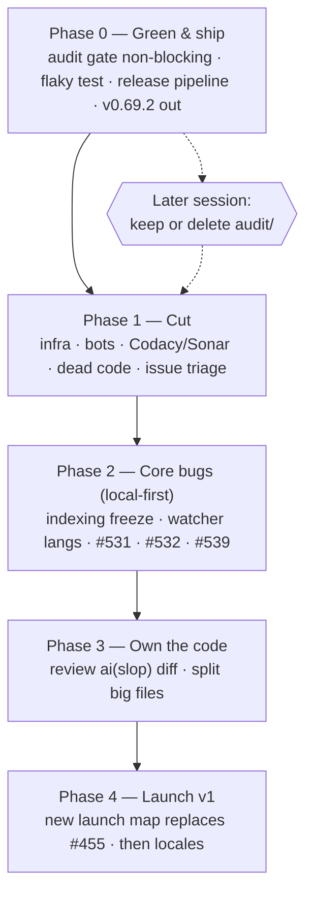

# Aperio Reset — green, lean, shipped

> Written 2026-10-22, after a 7-week pause (last feature work 2026-08-31).
> Source: full-repo audit of the same day + two grilling rounds with the developer.
> Companion tests: `trash/plans/aperio-reset/aperio-reset-tests.md`.

## Objective

Get Aperio back to a state one person can maintain and ship: CI green, a working release
pipeline, side-projects cut, core bugs fixed — so a public v1 (for non-coders **and** devs,
local models first) can launch from a known-good base.

## Decisions locked (2026-10-22 — do not re-ask)

| Topic | Decision |
|---|---|
| Purpose | Public product + portfolio piece. Personal daily use comes along for free. |
| Core features kept | Memory + chat (web UI), docgraph + doc intelligence, codegraph, terminal chat + MCP for other agents. |
| Database | Keep **both** SQLite and Postgres (devs are a target audience). |
| Providers | Keep all 6. **Focus is local models (llama.cpp).** Cloud providers get attention in later releases. |
| Locales | Keep all 26 and keep issues #421/#422. No new i18n work until the cleanup is done. |
| Continuous-audit program | Must **not block** anything now. Keep or delete is decided in a later session. |
| Cut | Bot/gamification workflows, Codacy + Sonar. |
| Infra on master (2026-10-22, revised) | **`k8s/`, `vms/` and `cd.k3s-deploy.yml` STAY on `master`.** `release` becomes the official installation branch and is stripped there; future contributors branch from `master`, where this infra is still useful. The aperio.live *deploy* stays cut as a goal — nothing is deployed — but the files are not deleted. This retires step S1.1. |
| Quality metrics | Keep some proof of quality: Codecov + CodeQL + npm-audit gate stay. **S1.3 found CodeQL was itself `disabled_manually` since 2026-07-05 — re-enabled 2026-10-22.** Of the four README quality badges, three were rendering frozen July data. |
| Old crossed-out epics | Not needed, may be revisited. Close as *not planned* (reopenable). |
| Deleted work | Nothing is lost: an annotated tag `archive/pre-reset-2026-10-22` is pushed before Phase 1, and closed issues stay reopenable. Recover with `git checkout archive/pre-reset-2026-10-22 -- <path>`. |
| Pace | Full-time for some weeks, but in small shippable steps (one PR / one push each). |
| Version numbers (2026-10-22, after S0.4) | **S0.4 shipped v0.69.2, not v0.70.x.** The bump is computed from the commits since the last tag, and the range held 11 `fix:` commits and zero `feat:` — so SemVer says patch, and the plan's round number was never earned. **v0.70.0 is reserved for the Phase 4 launch (S4.1)**, to be carried by a real `feat:`. Do not spend it on a cleanup step. |

## Audit snapshot (2026-10-22, master @ e44648d1)

- Unit tests: 2900/2900 green locally.
- **No release since v0.68.0 (2026-07-22).** Tags `v0.69.0`, `v0.69.1` exist with no GitHub
  release; the packaging job was skipped. The 1 September launch did not ship.
- Release trigger reads only the **head** commit message of a push, so a `fix:` followed
  by a `chore:` in one push never releases (happened 2026-10-17).
- CI red: `continuous-audit gates` (#569) since 2026-10-16; `install matrix` macOS fails
  on flaky `createMetricsSampler › never runs overlapping samples`.
- Size: ~87k lines app, ~103k lines tests, 14.5k lines `audit/` (ledger has 0 runs),
  29 workflows, 84 npm scripts, 41 deps, ~120 config keys.
- 20 `ai(slop)` commits: 284 files, +15,990 / −3,487 lines landed without review.
- Master ruleset requires only `GitGuardian Security Checks` + `code_quality` — removing
  Sonar/Codacy breaks no required check.

## Diagram

## Model recommendation

| Work | Model | Why |
|---|---|---|
| Release pipeline (S0.3), security-adjacent fixes (S2.1, S1.4) | Claude Opus | Multi-file CI + security reasoning; mistakes here cost a release or a leak. |
| Deletions, issue triage, workflow removal (Phase 1) | Claude Sonnet or local Qwen2.5-Coder-7B | Mechanical; the tests file is the safety net. |
| Concurrency bugs (S2.2, S2.4) | Claude Opus | Event-loop and race reasoning. |
| Code review of `ai(slop)` diff (S3.1) | Claude Opus + developer | Judgment work; the developer must end up owning the code. |

Estimate for the whole plan: ~3–5M input / ~300k output tokens, mostly cached reads.
Roughly $15–40 on Opus; much less if Phase 1 runs on Sonnet/local.

## Steps

Each step = one push. Tests are in the companion file under the same step ID.

### Phase 0 — Green & ship

**S0.1 Audit gate stops blocking.**
Change `.github/workflows/ci.audit.yml` triggers to `workflow_dispatch` only (keep the file).
Do **not** fix #569 by editing `lib/config.js` yet — that file is a No-Touch Zone; ask first.
*Works when:* a push to master runs no audit job, and `npm run test:audit` still runs locally.
Tests: T0.1.

**S0.2 Fix the flaky metrics-sampler test.**
`tests/unit/helpers/metricsSampler.test.js` "never runs overlapping samples" depends on
wall-clock timing. Make it deterministic (fake timers / injected clock), do not loosen it.
*Works when:* the test passes 50/50 runs locally and on the next macOS install-matrix run.
Tests: T0.2.

**S0.3 Fix the release pipeline.**
1. Find the root cause of the skipped `package-source` job for v0.69.0/v0.69.1 (the
   v0.69.1 run failed at `git push` — check the `master-rules` ruleset's `pull_request`
   rule against the bot push). Prove the cause from logs before changing anything.
2. Compute the bump from **all commits since the last tag**, not only the head commit.
3. Add a manual `workflow_dispatch` path that packages an existing tag.
*Works when:* a push of `fix: x` then `chore: y` produces a patch release; a dispatch on
an existing tag produces a release with `aperio-lite.zip` attached.
Tests: T0.3.

**S0.4 Ship the first release since July.** — **DONE 2026-10-22: v0.69.2.**
Cut from the green master. The number is **v0.69.2**, not v0.70.x: the S0.3 bump logic read
37 commits since v0.69.1 and counted 11 `fix:` with no `feat:`, so patch is the honest
answer. v0.70.0 is reserved for S4.1 — see the Decisions-locked table.
*Worked:* release v0.69.2 published with `aperio-lite.zip` (6.44 MB, against the 5.1 MB
v0.68.0 baseline); lite smoke green on the tag across all five runners
(`gh workflow run ci.lite-smoke.yml --ref v0.69.2`, run `39820710035`); `origin/release`
== the tag's commit `52778b7b`, the first time that branch has moved off v0.68.0.
Also backfilled by hand: **v0.69.1 now has a release** (dispatch run `39819904949`, which
wrote no commit, tag or branch — the mode=package path doing its job). **v0.69.0 stays a
bare tag** by decision: two releases superseded it within days.
Tests: T0.4 — all checks pass.

### Phase 1 — Cut

**S1.0 Archive tag (do this first).** Before any delete, create and push an annotated tag
on the current green master so every cut file keeps one named, permanent address:
`git tag -a archive/pre-reset-2026-10-22 -m "state before the Aperio Reset cut"` then
`git push origin archive/pre-reset-2026-10-22`. Recovery for any path afterwards is
`git checkout archive/pre-reset-2026-10-22 -- <path>`.
*Works when:* the tag is visible on GitHub and a test checkout of `k8s/` from it succeeds.
Tests: T1.0.

**S1.1 Remove infra.** — **DROPPED 2026-10-22 by developer decision. Do not re-plan it.**
Nothing is deleted. Reason: `master` is the branch future contributors fork from, and the
stripping happens on `release`, which becomes the official installation branch. Deleting the
files on `master` would be work undone later.

Two findings from the aborted consumer sweep are kept because they outlive the step:

1. **`vms/` is not optional infra — it is load-bearing CI.** Three live workflows execute
   files inside it: `ci.install-matrix.yml` (`vms/smoke.sh`, `vms/smoke.ps1`, trigger
   `vms/**`), `ci.lite-smoke.yml` (`vms/smoke.sh`, `vms/smoke.ps1` — the workflow that
   verified v0.69.2) and `ci.docker-smoke.yml` (`vms/docker/run.sh`, trigger
   `vms/docker/**`). `tests/integration/vms/` is therefore **shared, not Vagrant-only**:
   `smoke-contract.test.js` (6), `ci-workflows.test.js` (5) and `docker-executor.test.js`
   (5) pin the CI contract; only `vagrant-executor.test.js` (3), `mac-executor.test.js` (5)
   and `windows-executor.test.js` (3) are local-VM-only. **Any later strip of `vms/` on
   `release` must keep `smoke.sh`, `smoke.ps1` and `docker/run.sh`, or three workflows and
   the release verification path go red.**
2. **`APERIO_PI_WEBHOOK_URL` / `APERIO_PI_WEBHOOK_SECRET` are already dead secrets.** The
   only reader is the *commented-out* "Notify Pi" step in `cd.k3s-deploy.yml`. They can be
   deleted by hand at any time (GitHub → Settings → Secrets and variables → Actions)
   without touching code. Not an action item for this plan.

`k8s/` consumers, for whoever does the `release` strip: `cd.k3s-deploy.yml` (trigger
`k8s/**`, header points at `k8s/aperio-webhook.service`), `id/reference/ci-cd.md:109-115`,
`SECURITY.md:208,220`, `docker/Dockerfile:39` (comment), `docs/guides/k8s.html` + its nav
link in `docs/index.html:81`, and `CHANGELOG.md` (history, keep). The `k8s` hits in
`lib/agent/index.js:160`, `lib/routes/api-meta.js:351` and `lib/helpers/selfRestart.js:9`
are the generic word for a supervisor, not deploy code — never touch those.

`lite-zip-decouple` is unaffected: its `k8s/*` and `vms/*` exclude-list entries all still
apply, because nothing was deleted.

**#239, #240, #241 (aperio.live epic) move to S1.5**, where the rest of the issue triage
lives. They are still closed as *not planned* — the deploy goal is cut even though the
files stay.
*Works when:* n/a — retired step.
Tests: T1.1 retired.

**S1.2 Retire the bot/gamification workflows.** — **DONE 2026-10-22.**
**Revised 2026-10-22: park, do not delete.** The developer chose to keep every file so the
work behind it is not lost. `.github/workflows/obsolete/` is therefore **not** deleted — it
becomes the standing parking lot, and `obsolete/` is where retired workflows live from now
on. GitHub Actions scans only `.github/workflows/*.yml`, never a subdirectory, so a parked
file cannot run.

Moved into `.github/workflows/obsolete/`, each with its `on:` block stripped to
`workflow_dispatch:` plus a PARKED banner, so it stays inert even if the file is moved back
up by accident: `bot.issue-claim-guard.yml`, `bot.stale-claims.yml`,
`bot.issue-moderation.yml`, `community.contributor-agreement.yml`,
`community.update-leaderboard.yml`.

**Kept active:** `bot.nuke.yml` and `bot.pin-shas-to-actions.yml`. The first is
dispatch-only and dry-run by default, and shares `.github/scripts/nuke.cjs` +
`.github/data/blocklist.json` with `ci.pr-guard.yml`, which stays. The second is a real
supply-chain guard that pins third-party action SHAs on every PR touching
`.github/workflows/**` — gamification it is not.

**Labels: none deleted, by developer decision.** `robin-hood` (1 open / 29 closed),
`🛡️ 100xp` (1 / 20), `🛡️ 50xp` (0 / 4), `🛡️ 25xp` (0 / 4), `🛡️ 75xp` (0 / 2) and
`status: claimed` (0 / 6) all stay. Deleting a label strips it from 65 closed issues and
that is irreversible. The blanket `muted` label on open issues is still S1.5's business.

**Data files kept, now unread by any active workflow:** `.github/data/seniority-tiers.json`
(claim-guard tiers, its only reader was the claim guard) and `.github/LEADERBOARD.md` (the
standings the leaderboard job wrote).

**Nothing shared was removed.** All five parked workflows ran inline
`actions/github-script`; no `.github/scripts/` file became dead. `cd.release.yml` builds
`launchers/` itself (lines 91, 300, 322) and never called the parked
`obsolete/cd.aperio-lite-launchers.yml`.

**Two plan expectations that did not hold:** `CONTRIBUTING.md` has no XP or leaderboard
text — only line 18 links to a *Payment & Bounty Policy* GitHub Discussion, left untouched
because it lives outside the repo and the developer deleted nothing. `README.md` is clean.
`FEATURES.md:139` says "claim" about the interrupt service; unrelated, kept.
*Worked:* no active workflow names a parked file; `actionlint .github/workflows/*.yml`
reports only the pre-existing shellcheck info/warnings; `npm run test:unit` green.
Tests: T1.2 — pass.

**S1.3 Retire Codacy + Sonar, revive CodeQL.** — **DONE 2026-10-22.**
**Revised: park, do not delete** — same treatment as S1.2. `ci.codacy.yml` and
`ci.sonarqube.yml` moved to `.github/workflows/obsolete/` with their `on:` blocks stripped
to `workflow_dispatch:` and a PARKED banner. **There were no config files to delete** —
both tools were configured entirely inside their workflow YAML (`-Dsonar.*` args inline for
Sonar, the action's own defaults for Codacy). Nothing in `lib/`, `db/`, `mcp/` or `tests/`
references either tool; the one `grep` hit in `tests/e2e/helpers/test-agent.js` is `jsonArgs`
matching "sonAr".

**The step's premise was wrong, and the real finding is bigger.** Both tools were already
`disabled_manually` on GitHub and neither had run since **2026-07-05**. Codacy had **never
passed**: 0 successes in its last 100 runs (62 failures, 38 cancelled). Sonar was 100/100
green but three and a half months stale. So the step won **zero CI minutes**. What it
actually won was two README badges that had stopped telling the truth. And the same sweep
found **`ci.codeql.yml` was `disabled_manually` too** — the gate this plan's
Decisions-locked table says to keep. It was **re-enabled 2026-10-22**. Note it has no
`push` trigger (PRs to `master`, Sunday 08:17 UTC, or dispatch), so a direct commit to
`master` never refreshes its badge.

**Required checks were never at risk.** `master-rules` requires exactly one context:
`GitGuardian Security Checks`. The plan's claim that `code_quality` is also required is
**out of date** — it is not in the ruleset.

**Docs edited:** README badges for Sonar and Codacy removed (a parked workflow can never
refresh them); `SECURITY.md` monitoring table lost both rows and now honestly says *three*
layers, not two; `FEATURES.md` CI line drops SonarCloud + Codacy; `id/reference/ci-cd.md`
gains a **Disabled on GitHub** section, because a workflow switched off in the Actions UI
looks live in the tree and no `grep` can reveal it.

**Report-only — three dead repository secrets to delete by hand:**
`CODACY_PROJECT_TOKEN`, `SONAR_TOKEN`, `SONAR_HOST_URL`.
*Worked:* `actionlint` clean bar pre-existing notes; `ci.codeql.yml` reports `active`;
no doc or workflow names either parked file outside the parked section.
Tests: T1.3 — pass.

**S1.4 Dead code.** **Deferred by developer decision (2026-10-22).** `lib/agent/spawn.js`
(#319) is live product code, not CI clutter, and the planning-UX epic #498 is still
undecided — the same reason this step already gives for leaving `plan_created` /
`plan_step` / `plan_drift` (#320) alone. Keep both until #498 is decided, then revisit
in one step. The latent agent-permission gap (F-R3-04) therefore stays open; it is
tracked in `id/reference/tech-debt.md` and must not be closed by this plan.
*Works when:* #319 and #320 carry a comment pointing at #498; no code is removed here.
Tests: T1.4.

**S1.5 Issue triage.** — **DONE 2026-10-22.** First pass closed #239, #240, #241 as
*not planned* (moved here from the dropped S1.1), each with a comment recording that the
aperio.live deploy is cut, that `k8s/` and `cd.k3s-deploy.yml` nonetheless stay on `master`,
where the plans live (`trash/plans/aperio-live/`), and that the pre-cut tree is tagged
`archive/pre-reset-2026-10-22`. Second pass closed #335, #202, #105 as *not planned* (all
three already had struck-through titles and sit outside the locked core) and closed map #455,
whose 1 September date had passed and whose 13 tickets were all resolved — its comment hands
launch planning to Phase 4 and records that v0.70.0 is reserved for S4.1. All seven are
reopenable.
The blanket `muted` label was the real finding: it sat on **all 26** open issues, so it
carried no signal at all. It is now removed from every one of the 22 that stay open; the
label itself is not deleted. Of those 22 the plan names only nine (#319, #320, #421, #422,
#498, #531, #532, #539, #569), so the other thirteen were given a note rather than left
ambiguous — #250 and #251 marked in-scope (doc intelligence is a locked kept feature, next
action WS4 / T-G6), and #187, #321, #338, #355, #356, #357, #358, #359, #361, #476, #528
parked until after Phase 4. #355–#359 and #321 are one family (the multi-turn harness); #361
is the spec map behind the still-undecided #498, so it parks for the same reason S1.4 gives.
*Worked:* 22 open issues, zero carrying `muted`, every one named in this plan or carrying a
parked/in-scope note.
Tests: T1.5.

### Phase 2 — Core bugs (local-model first)

**S2.1 Indexing must not freeze the server.** — **DONE 2026-10-22.**
Move codegraph/docgraph extraction off the main thread (worker) or yield between files.
Measure first: time `/api/version` during a big index run before and after.

**The step's "or" was wrong — both halves were needed.** `await readFile` between files
already yields, so a pass over ordinary source never froze anything: the baseline there was
p95 25 ms, comfortably inside the target. The freeze lived *inside* one file, in two places
the plan did not name. Extraction is one of them and a worker fixes it, because
`parser.parse(source)` is a single atomic WASM call that cannot be sliced (204 ms for an
0.8 MB file, linear in size). The other is the write loop: one bundle-shaped file is ~32k
synchronous better-sqlite3 statements, ~2.2 s with no yield point in it. A worker alone
would have left that.

**What shipped.** Extraction runs on a worker thread for both graphs
(`lib/codegraph/extract-worker.js`, `lib/docgraph/extract-worker.js`, pooled by
`lib/helpers/extractorPool.js` with a closed key registry, lazy spawn, idle terminate and
automatic in-process fallback). The SQLite write loops yield through
`lib/helpers/timeSlice.js`. The codegraph edge resolver, previously one statement over every
edge in the repo (365 ms on a 175k-edge graph, unsliceable), is batched by edge id.
**Postgres needed no change** — every statement there is an awaited round trip, so it already
yields; its extraction benefits for free from the indexer-level swap. `lib/config.js` was
not touched: the five tunables are module constants and are logged in `A2D.md`.

**Measured, isolated scratch instance** (scratch DB, port 48731, scratch cwd), `/api/version`
during a full pass, p95 / p99 / worst:

| corpus | before | after |
|---|---|---|
| 804 ordinary source files | 25 / 46 / 55 ms | 9 / 13 / 96 ms |
| the same plus six bundle-shaped files | 29 / 2700 / 3012 ms | 8 / 27 / 138 ms |
| 189 documents, one of them 13 MB | — / 1225 / 1248 ms | 11 / 14 / 18 ms |

**p95 hid the bug, and that is the lesson.** The code corpus *passed* at p95 while the
server went unanswered for three seconds at a time. The document corpus is the one that
failed the gate outright (p95 294 ms on the first run). Its baseline p95 is left blank above
rather than guessed: the pass blocked so hard that the prober landed 69 of ~250 samples, and
a p95 over that few samples is noise. Any future freeze claim in this repo should carry
worst-case next to p95.

**Two latent bugs found by measuring, both of the "succeeds while silently wrong" kind:**
1. Smallest-enclosing-symbol lookup in **both** code extractors was O(symbols × call sites)
   — 511 ms of a 613 ms extraction on a file with 8k functions, and quadratic: 16k functions
   took 1.7 s, now 0.7 s. The two extractors carried the same scan verbatim; they now share
   `lib/codegraph/owner-index.js`. A differential run against the old implementation caught
   that its tie-break was *positional*, which a sorted backward scan flips.
2. **A Buffer does not survive structured clone as a Buffer.** It arrives as a plain
   Uint8Array, whose `toString('utf8')` returns `"104,101,108,…"`. Every docgraph extractor
   does exactly that call, so the first worker run indexed the whole corpus "successfully"
   while collapsing 2670 sections into 189. Only the result-identity check saw it.

*Worked:* p95 during indexing 8–11 ms across all three corpora, zero samples over 200 ms,
against a 200 ms target. Indexing results **byte-for-byte identical** before and after — same
files, symbols, edges, resolved edges, documents, sections, chunks — and total index time
unchanged (±3%). `npm run test:unit` 2942/2942 (2900 + 42 new), `npm run test:harness` 33/33,
`test:integration` 2744/2744, `test:docint` 111/111, `test:e2e` 113/113. Both new regression
tests were run against a pristine `HEAD` checkout and **fail** there, while the
result-identity test passes on both sides — which is what proves nothing was lost. Teardown
left nothing in the repo tree.
Tests: T2.1 — pass.

**S2.2 Codegraph watcher indexes every supported language.** — **DONE 2026-10-22.**
One shared predicate for `watcher.js isIndexable()` and `indexer.js pickExtractor()`.

**The bug was wider than this line said, and it was two bugs, not one.**
1. **The language gap.** `pickExtractor()` accepted `JS_EXT` *plus* `extract-generic.js`'s
   25 `SUPPORTED_EXTS` (`bash c cc cpp cs cxx gemspec go h hh hpp hxx java kt kts php phtml
   py pyi rake rb rs sh swift zsh`). `watcher.js isIndexable()` checked `JS_EXT` and nothing
   else. So the initial `indexRepo` pass *did* index all 25 and every live save to 25 of
   them was then dropped in silence — a C# or Python repo indexed once on startup and went
   stale forever with no error anywhere. The chokidar `ignored` option did **not** have this
   half of the gap; it never filtered by extension at all.
2. **The absolute-path `SKIP_DIRS` split** (second asymmetry, folded into this step by
   developer decision rather than given its own step: it is the same two call sites in the
   same function, the fix was already proven in docgraph, and the T2.2 test could not
   otherwise exercise a real temp root). Both `isIndexable()` and the chokidar `ignored`
   split the **absolute** path and rejected any segment in `SKIP_DIRS`, so a root under
   `build/`, `bin/`, `out/`, `var/` or `trash/` — e.g. `/Users/me/build/myproject`, or any
   macOS temp dir, which resolves under `/private/var/folders/...` — had every file
   rejected. docgraph scoped the same check to the path *relative* to the root on
   2026-08-21; codegraph never got that fix.

**What shipped.** `pickExtractor()` is now exported from `lib/codegraph/indexer.js` and is
the single authority on indexability — `walk()`, `indexFile()` and the watcher's
`isIndexable()` all route through that one call, so extension support is no longer decided
in the watcher at all. `JS_EXT` stopped being exported, because exporting it is exactly how
the two predicates drifted apart. `lib/codegraph/watcher.js` gained `hasSkippedSegment(root,
abs)` and `isIndexable(root, abs)` copied from the docgraph shape, and the chokidar
`ignored` option uses the same `hasSkippedSegment`. **docgraph was not touched** — no defect
was found in it; it is the model, as instructed. `lib/config.js` was not touched.

**Grep proof of the one shared predicate** (asked for explicitly, not asserted): every
`pickExtractor` call site in `lib/codegraph/` is `indexer.js:56` (the definition),
`indexer.js:102` (`walk`), `indexer.js:140` (`indexFile`) and `watcher.js:95`
(`isIndexable`). There is no other extension test anywhere in the directory.

*Worked:* a real chokidar watcher over a real tree with a real better-sqlite3 database
behind it — add, change and unlink on `.js`, `.cs`, `.py` and `.go` each update `cg_symbols`
within the debounce window with no restart; an unsupported `.txt` produces no event and no
rows. Green in **both** watch modes (native and the polling fallback —
`APERIO_TEST_WATCH_POLLING=1` forces polling, since a pass that only works under native fs
events is not a pass). `npm run test:unit` 2984/2984 (2942 + 42 new),
`npm run test:harness` 33/33, `npm run test:integration` 2750/2750 (2744 + 6 new).

**The regression test was verified red against a pristine `git archive HEAD` tree**, and the
two bugs were separated there rather than proven as one blur: under a macOS temp root
(`/private/var/...`) **5 of 6** tests failed, because bug 2 rejects every file including the
`.js` one; re-run with `TMPDIR` pointed at a path containing no skip-dir segment, **exactly**
`.cs`, `.py` and `.go` failed and `.js` passed — which is bug 1 alone, with no help from bug
2. The unit tests also go red on `HEAD`, but only as an import error for the new exports,
which is a weak red; the integration test carries the real proof. Teardown left nothing in
the repo tree.
*Works when:* saving a `.cs`/`.py`/`.go` file updates the graph without restart.
Tests: T2.2 — pass.

**S2.3 Settings overlay timeout.** — **DONE 2026-10-22.**
`public/scripts/settings-overlay.js` `load()` gets an abort deadline and a distinct
"server is busy" message.

**What shipped.** `load()` now creates an `AbortController`, passes its signal to
`fetch("/api/config/schema")` and arms a `LOAD_TIMEOUT_MS = 8000` deadline that aborts
it. The controller is kept in a module-level `loadAbort`, so the close branch of
`toggleSettingsOverlay()` cancels an in-flight request and a second `load()` supersedes
the first instead of racing it. The timer is cleared in a `finally` on every path.

**"Busy" is a third state, not a re-use of the failure string.** A new locale key
`stov_load_busy` ("Server is busy — configuration did not load in time") sits beside the
existing `stov_load_failed`; a rejected fetch still reads "Failed to load configuration".
A cancel that is *not* the deadline (panel closed, or superseded) paints nothing at all —
a user-initiated close is not an error.

**The save path was checked, not assumed.** `saveAll()` calls `await load()` at line 474
with `stovSaveBtn` already disabled. `load()` swallows its own failure rather than
throwing, so `saveAll()`'s `finally` still re-enables the button — a timed-out re-read
cannot leave the save button dead.

**Timeout value.** Module constant, by developer decision — the S2.1 precedent. Not a
`lib/config.js` key, so that No-Touch Zone and `gen:env` were not touched. Logged to
`A2D.md` as a candidate config key if a user ever needs to raise it.

**Reported, deliberately not fixed (out of scope).** The `PUT /api/settings/...` writes in
`saveAll()` (line 462) are also un-timed, so a wedged server hangs a save the same way —
worth its own step. The `restartAperio()` ping at line 549 is un-timed **by design**: the
connection is expected to drop and the 90 s deadline loop is the real guard there.
*Works when:* a hung `/api/config/schema` shows the busy message within the timeout.
Tests: T2.3 — pass.

**S2.4 Docgraph → memory bridge races (#532).** Tests: T2.4.

**S2.5 Privacy redact mode (#531).** Either wire `restore()` into the reply path or remove
the `redact` mode until cloud providers are in focus. Recommend: wire it (small, and it is a
user-visible bug). Tests: T2.5.

**S2.6 Terminal parity (#539) + a real test seam for `runStandalone`** (injectable
stdin/stdout/agent). Tests: T2.6.

### Phase 3 — Own the code

**S3.1 Review the `ai(slop)` commits.** List all 20 with diffstat; review in batches with
the developer; delete what is unused, test what stays. Log leftovers to tech-debt.md.
*Works when:* every file touched by those commits is either reviewed or deleted.
Tests: T3.1.

**S3.2 Split the biggest hand-written files** where cohesive: `db/sqlite/store.js` (1589),
`db/postgres/store.js` (1395), `lib/agent/index.js` (1103). Only safe, local splits.
Tests: T3.2.

### Phase 4 — Launch v1

**S4.1 New launch map.** Re-check the #455 decisions (most should still hold), pick a new
date, open a fresh map. Local models lead the story. **This is where v0.70.0 is spent** —
S0.4 shipped v0.69.2, so the round number is still free and should ride a real `feat:`.
**S4.2 Locales.** Resume #421/#422 only after S4.1 is set.
Tests: T4.1.

## Risks

| Risk | Mitigation |
|---|---|
| Release fix creates duplicate or wrong tags. | Test on a fork or with `workflow_dispatch` + dry-run flag first; never `--force` a tag that has a release. |
| Ruleset blocks the bot push (likely S0.3 root cause). | Prove it from logs; fix with a ruleset bypass for the release actor, not by dropping protection. |
| Deleting a workflow that a doc, badge, or script still references. | T1.x greps for every removed filename before the push. |
| Removing `spawn.js` kills a planned feature. | **Open question:** is sub-agent spawn on the roadmap? If yes, keep it and wire enforcement instead. |
| `#320` plan events tie into #498. | Keep them until #498 is decided. |
| #569 fix needs `lib/config.js` (No-Touch Zone). | Ask before editing; run `npm run gen:env` + `gen:env:check`. |
| Scope creep inside "small steps". | One step = one push. Anything new goes to A2D.md, not into the current step. |

## Doc updates

- `README.md` — badges (S1.3). No infra edit: S1.1 is dropped.
- `CONTRIBUTING.md` — claims/XP text (S1.2).
- `FEATURES.md` — no edit needed: S1.1 is dropped and S1.4 is deferred. (`aperio.live` does not appear in it; the one `claim` hit is the interrupt service.)
- `id/reference/ci-cd.md` — workflow list + release flow (S0.1, S0.3, S1.x).
- `id/reference/tech-debt.md` — delete entries as they are fixed (S2.x, F-R3-04 after S1.4).
- `CHANGELOG.md` — `## Unreleased` entry per step.
- `SECURITY.md` — only if S2.5 changes redact-mode behaviour.
