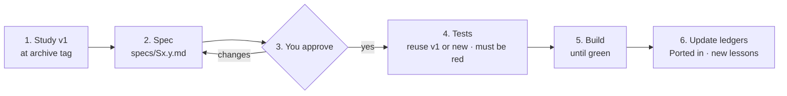
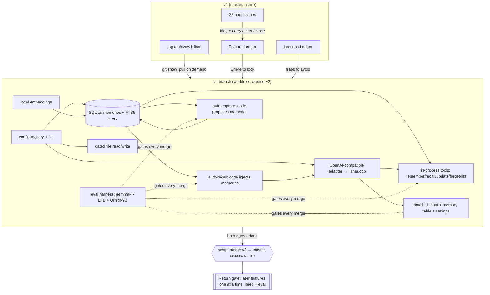

# Aperio v2 — fresh core, nothing forgotten

Status: **active, 2026-11-01** — **Phase 0 complete. S1.1 complete.** Next: **S1.2**.

> **This copy, on branch `v2`, is the live plan from S1.1 onward.** The copy on `master` is frozen
> at "Phase 0 complete" — it records only what was done on `master`. Record every Phase 1–4 result
> here. Supersedes `trash/plans/aperio-reset/` once approved
(see S0.6). Tests: `trash/plans/aperio-v2/aperio-v2-tests.md`.

## Objective

Rebuild Aperio as a small core that a 4–9B local model uses well, in the same GitHub repo,
without losing any feature, lesson or open thread from v1 — so you stop carrying weight
you do not need now.

## The one rule

**On a small model, code does the memory work. The model does the talking.**
Recall is woven into the turn by code, not a tool the model must remember to call.
Every v2 choice answers to that.

---

## Decisions locked (grill, 2026-10-30 — do not re-ask)

| Topic | Decision |
|---|---|
| Repo | Same GitHub repo (option A). |
| Where v2 is built | On a `v2` branch. Swap with `master` when we both agree it is done. |
| v1 safety | Tag `archive/v1-final` holds every v1 file forever. |
| In-flight v1 work | The other session's store split finishes and commits first. Then we archive. |
| UI | New small UI. Copy parts in one by one. Every new look is previewed first. |
| UI tech | **No framework, no build step. Angular-style structure:** one native Web Component per file, plain service modules, one tiny store on `EventTarget`, `// @ts-check` + JSDoc checked by `tsc --noEmit` in CI. **Switch to Angular** only at a return gate, and only if one of these is true: > ~10 screens, > ~5k UI lines, or a returning feature needs heavy forms or routing. |
| v1 launch vs v2 | **DECIDED 2026-11-01: drop the v1 public launch.** v2 starts now and launches as v1.0.0. The 2026-12-15 date is cancelled. |
| Is `master` frozen? | **DECIDED 2026-11-01: no.** `master` stays active and may take work when needed (not security fixes only). `archive/v1-final` means "v1 at the moment v2 started", so later `master` commits cannot rot the ledgers — every study step reads the tag, never live `master`. |
| Later features (gated) | Doc intelligence · Wiki · Cloud providers + Postgres · Code graph + terminal CLI · Shell + GitHub tools. |
| Self-memory | Parked. Comes back only if a test shows a small model does better with it. |
| Return gate | After v1.0.0 ships. One feature at a time. Needs a real need + a test score that goes up. |
| Never (archive only) | k8s / vms / k3s deploy · agent jobs + turn planner + planning UX · autotune + tier bench + continuous audit + bot workflows + mascot/demo pipelines. |
| Test models | `unsloth/gemma-4-E4B-it-qat-GGUF:UD-Q4_K_XL` and `protoLabsAI/Ornith-1.0-9B-MTP-GGUF:Q4_K_M`. Both must pass. |
| First v2 version | **v1.0.0**. The v0.70.0 the reset plan reserved is dropped. |
| Locales | English only at first. |
| Skills in core | `memory-protocol`, `working-with-files`, `agent-conduct`, `conversation-lifecycle`. Each one gets cut down for small models. |
| Open issues that don't fit | Closed with a note. Issues for later features stay open with a label. |
| **MCP server** | **Not in core. Parked as `later`.** Aperio is no longer a memory layer for other agents. Tools are plain in-process functions behind one small interface, so a thin MCP wrapper can come back through the return gate. The tagline "One brain. Every agent." changes at the swap. |
| **Study → Spec first** | Before any v2 step: study how v1 did it (best parts, bad parts, lessons, tests). Write a spec. You approve the spec. Only then tests, then code. No spec, no code. |
| **TDD** | **Tests before every feature.** Reuse a v1 test when one fits (copied from the tag, then cut down). Otherwise write a new one. The test must fail first. |

---

## What "option A + v2 branch" means

```
master ──●──●──●  (v1, still active; no v1 launch)          ─────►  ●  merge v2 = swap
          \                                                          /
           tag archive/v1-final (forever)                           /
            \                                                      /
v2           ●── wipe ── core ── core ── UI ── eval green ── done ─●
release  (install branch) stays on v0.69.4 ───────────────────────────► v1.0.0
```

- **`master`** stays v1 while v2 is built. It stays working. Only security fixes go there.
- **`v2`** branches from `master`. Its first commit deletes the v1 tree (except a short keep list).
  Because it branches from master, the history is shared. So the swap at the end is a normal merge.
- **`archive/v1-final`** (a tag) is the permanent address of every v1 file:
  `git show archive/v1-final:lib/routes/paths.js`. Nothing is lost.
- **`release`** is what users install. It stays on v1 (v0.69.4) until v1.0.0 is released.
- **A separate folder for v2.** Other sessions work in this folder on `master`. Switching branches
  here would break them. So v2 lives in its own git worktree, which is a second folder with the
  `v2` branch checked out:
  `git worktree add ../aperio-v2 -b v2`
  Your `.env`, `var/` and models stay where they are. v2 points to them through config.

---

## How we do not forget anything

There are three safety nets. Each one has a test in the tests file.

1. **Archive tag.** Every v1 byte, by name, forever. It is never deleted.
2. **Feature Ledger** — `trash/plans/aperio-v2/feature-ledger.md`. One row for every feature in
   `FEATURES.md`, every MCP tool, every UI panel and every skill:

   | Feature | v2 status | v1 files (at tag) | v1 tests (at tag) | Issues | Lessons | Ported in |
   |---|---|---|---|---|---|---|
   | Recall (hybrid search) | core | `db/sqlite/store.js`, `mcp/tools/memory.js` | `tests/integration/store/store.test.js`, `tests/unit/memory/recall-corpus.test.js` | — | L-07, L-12 | (commit) |
   | Docgraph | later | `lib/docgraph/**`, `public/scripts/docgraph-panel.js` | `tests/docint/**` | #250 #251 #532 | L-21 | — |
   | Turn planner | never | `lib/agent/turn-planner.js` | `tests/harness/planning.test.js` | #498 #361 | L-30 | — |

   Status is one of `core` / `later` / `parked` / `never`. No row may be blank.
   When a later feature comes back, its row tells you exactly where to look.
3. **Lessons Ledger** — `trash/plans/aperio-v2/lessons-ledger.md`. Every hard-won trap goes here.
   The sources are `id/reference/tech-debt.md`, `CHANGELOG.md`, the Claude memory notes and the
   reset plan. Examples: `Buffer` through `structuredClone`; set scratch env vars before import;
   Docker volume `name:` breaks `-p` isolation; p95 hides freezes; small models treat 5 rows as
   "everything"; keychain `-A` flag; Windows `start.ps1` and benign npm stderr.
   Each lesson is one line plus a link to where it came from.

**Dogfood:** when v2 recall works, import both ledgers into v2's own memory. Then Aperio's own
chat recalls the v1 lessons by itself. That is anamnesis, used on ourselves.
(MCP is parked, so outside agents such as Claude Code do not reach that memory. They read the
ledger files instead.)

---

## The per-step loop: Study → Spec → Tests → Build

Every Phase 2 and Phase 3 step goes through this loop. It is the cure for "we are just dreaming":
v2 is built from what v1 really did, not from what we think it did.



1. **Study v1** (read only, at `archive/v1-final`). Answer these in writing:
   - How did v1 do it? Which files and functions, and how does the data flow?
   - **Best parts:** what worked and must be kept (a behaviour, an edge case, a clever fix).
   - **Bad parts:** what hurt (the anti-patterns AP1–AP9, bugs, complexity, things no one used).
   - **Lessons:** the matching rows in the Lessons Ledger, and closed issues or tech-debt notes for this area.
   - **v1 tests:** which ones exist, what they cover, and which can be reused.
   - **Numbers:** if it is measurable (speed, recall score, tokens), measure v1 now. That number is the bar.
2. **Spec** — write `trash/plans/aperio-v2/specs/<step>.md` from `specs/_template.md`. It is a
   contract: what it does, inputs and outputs, errors, limits, non-goals, and what it keeps or
   drops from v1 and why.
3. **You approve the spec.** Until then, no test and no code is written for that step.
4. **Tests** — taken from the spec's acceptance list. Reuse v1 tests where they fit (TDD rule).
   They must be red.
5. **Build** until green. If the build shows the spec is wrong, **fix the spec first** (and get it
   approved again), then the code. The spec never lags behind the code.
6. **Update the ledgers:** the Feature Ledger's "Ported in" cell, plus any new lesson.

Size rule: the study and the spec together are **1–2 pages**. If a spec gets longer, the step is
too big. Split it.

## Rules for writing v2 code ("port protocol")

These rules go into the new `AGENTS.md` (S1.2). Every port follows them:

1. **Test first (TDD).** Before any code:
   a. Look in the Test Reuse Map (below) and the ledger's "v1 tests" column.
   b. If a v1 test fits, copy it from the tag (`git show archive/v1-final:tests/...`), cut it to v2 scope
      and keep the edge cases. v1 tests hold years of found bugs, so they are the best place to start.
   c. If none fits, write a new test.
   d. Run it. **It must be red.** A test that passes before the code exists proves nothing.
   e. Write the code until it is green. Never weaken a ported test to make it pass. Change it only
      if v2 scope really differs, and write down why in the commit.
2. **Pull, don't push.** Copy code only when v2 needs it. Never copy a folder.
3. **Read at the tag:** `git show archive/v1-final:<path>`. Copy only the lines you need.
4. **Record it.** Fill the ledger's "Ported in" cell with the commit.
5. **Bring the lesson.** Check the Lessons Ledger for that area before you write.
6. **Hard rules, enforced by lint/CI:** the anti-pattern guards AP1–AP9 in the table below.
7. **Small-model budgets:** ≤ 6 tools per turn · system prompt ≤ ~1.5k tokens · the tool-schema
   prefix stays stable between turns (llama.cpp KV reuse — the lesson from #570).
8. **≤ ~500 lines per file** unless a reason is written at the top.
9. **One eval number per feature.** No number, no merge.

### Anti-patterns we must not repeat

Source: `trash/audits/anti-patterns-2026-10-30.md` (the v1 scan). Each one has a guard that **fails CI**,
not just a rule people must remember. Test group: **T1.3** (lint teeth) unless noted.

| # | v1 anti-pattern | v2 guard | How enforced |
|---|---|---|---|
| AP1 | `process.env` read in ~232 places, bypassing config | Only `src/config/` reads env (+ Tier-0 allowlist) | eslint `no-restricted-properties` |
| AP2 | Provider-name `if`s spread across the code | Callers ask for a capability, never a name | eslint `no-restricted-syntax` on `=== "<provider>"` outside `src/providers/` |
| AP3 | Raw `fs` in tools; check-then-use path gate (TOCTOU, a gap between the check and the file access) | Tools use only `gatedRead` / `gatedWrite` | eslint `no-restricted-imports` of `fs` in `src/tools/`, `src/mcp/`; T2.9 symlink-swap test |
| AP4 | Sync `fs` (`*Sync`) on the request path, which blocks every socket | Sync `fs` only in boot code | eslint `no-restricted-syntax` on `*Sync(` outside `src/boot/`; event-loop lag check in T2.1 |
| AP5 | Empty `catch {}` / `.catch(() => {})` hiding errors | Logic paths log or rethrow. Cleanup paths are marked `// cleanup` | eslint `no-empty` + custom rule for `.catch(() => {})` without a `// cleanup` marker |
| AP6 | Module-level caches with no size limit | Every cache uses one shared `boundedMap(max)` helper | eslint ban on module-level `new Map()` / `new Set()` with mutation outside `boundedMap` (constants allowed); unit test on the helper |
| AP7 | God files (1100–1600 lines) that grow back after a split | ≤ ~500 lines, or a written reason at the top | CI script fails a file > 500 lines with no `// size-reason:` header |
| AP8 | WebSocket messages with no schema, checked ad hoc | One shared message schema; validate once at the socket edge | Contract test: client + server import the same schema; an unknown or bad message is rejected (new step **S2.11**) |
| AP9 | Two files with the same name (`server.js`, `lib/server.js`) | Unique, descriptive file names | CI script fails duplicate basenames for entry files (`server`, `index`, `app` outside folders) |

Rule of thumb: **if a guard cannot be automated, it is not a guard.** Write it down as a
risk instead.

### Test Reuse Map (v1 tests to start from, at tag)

| v2 step | Start from these v1 tests | Then add new |
|---|---|---|
| S2.1 eval | `tests/harness/harness.test.js`, `tests/harness/no-tool-use-diagnostic.test.js`, `tests/unit/memory/recall-corpus.test.js` | multi-turn "used without hint" scenarios (#355–#359) |
| S2.2 config | `tests/integration/routes/config-provenance.test.js`, `config-schema.test.js`, `config-shadow-warning.test.js` | lint-rule teeth |
| S2.3 store | `tests/integration/store/store.test.js`, `tests/integration/db/sqlite.test.js`, `tests/unit/db/vec-fallback.test.js` | forget-cleans-vector case |
| S2.4 embeddings | `tests/integration/embeddings/reindex.test.js`, `tests/unit/helpers/embeddings.test.js` | signature mismatch |
| S2.5 provider | `tests/unit/providers/llamacpp.test.js`, `llamacpp-thinking-timeout.test.js`, `tests/unit/streaming/llamacppHandler*.test.js`, `tests/integration/helpers/startLlamaCpp.test.js` | bad tool JSON is reported, not `{}` |
| S2.6 auto-recall | `tests/unit/memory/tokenCount.test.js` | budget + stable-prefix tests (new) |
| S2.7 auto-capture | — | all new |
| S2.8 tools | `tests/unit/tools/memory.test.js` (tool behaviour; drop the MCP transport parts) | ctx snapshot, in-process call path |
| S2.9 file gate | `tests/integration/routes/paths.test.js` (+ #528 cases) | TOCTOU symlink swap |
| S3.x UI | `tests/e2e/ui/*` (pick per part) | Playwright per part (#338) |

The Feature Ledger's "v1 tests" column is the full list. This table shows only the core steps.

---

## Diagram



---

## Model recommendation

| Work | Model | Why |
|---|---|---|
| Ledgers, issue triage, skeleton, mechanical ports | Sonnet-class cloud or Ornith-9B locally | Mostly reading and copying. A script does most of the ledger. |
| Store, auto-recall, auto-capture, eval design | Opus-class | Load-bearing design. Hard to fix later. |
| UI port | Sonnet-class + your eyes | Visual approval is the real gate. |

Rough total: ~3–5M input / ~0.5M output tokens over the whole plan (spread across many sessions).
That is about $30–70 cloud at current Sonnet/Opus mixed pricing, and less if mechanical steps run locally.
This is an estimate, not measured.

---

## Steps

Each step names its test group from `aperio-v2-tests.md`.

### Phase 0 — Save v1 (on `master`, no code changes)

**S0.1 Clean start point.** Wait for the other session to commit its store split. Then check
that `git status` is clean, apart from files that belong to other sessions (leave those alone).
Check that CI on `master` is green, or write down exactly what is red (for example #569).
*Works when:* the archive commit is known and its CI state is written down. → **T0.1**

> **DONE 2026-11-01.** Worktree clean (no other-session files). Archive commit
> `de826ea2a87653f97f3d932f8aa117c94c5876aa` ("Merge branch 'master' of …/aperio").
> CI on `master`: green except **`(ci) generated artifacts`**, which is red from issue **#569**
> (unregistered env reads) and has been red since 2026-08-27. All other workflows pass:
> Codecov tests, npm audit, Browser E2E, lite smoke, install matrix, Pages.

**S0.2 Tag the archive.**
`git tag -a archive/v1-final -m "Aperio v1 final state before v2"` then `git push origin archive/v1-final`.
*Works when:* the tag is on GitHub, and `git show archive/v1-final:FEATURES.md` works from a fresh clone. → **T0.2**

> **DONE 2026-11-01.** Annotated tag `archive/v1-final` → `de826ea2`, pushed to `origin`.
> Verified from a fresh `--no-checkout` clone of GitHub: `cat-file -t` prints `tag`, and both
> `FEATURES.md` and `lib/routes/paths.js` print content.

**S0.3 Feature Ledger.** A script lists `FEATURES.md` headings, `mcp/tools/*`, `public/scripts/*`
panels and `skills/*`. Then each row gets its status, by hand, from the decisions table above.
*Works when:* every item has a row and a status, and no status cell is blank. → **T0.3**

> **DONE 2026-11-01.** `feature-ledger.md`, 119 rows in four tables: 24 features (20 `FEATURES.md`
> headings, four of which split core/later/never, plus a `Config registry` row), 16 MCP tools,
> 45 UI panels (44 scripts + the new memory inbox) and 34 skills. Checked by
> `scripts/check-ledgers.mjs`: every inventory item has a row, every status is one of the four
> words, no cell is blank, and the roll-up numbers match the tables.

**S0.4 Lessons Ledger.** Collect the traps from the sources listed above.
*Works when:* every open item in `tech-debt.md` is a lesson or a ledger link, and every
`feedback_*` memory note has a line. → **T0.4**

> **DONE 2026-11-01.** `lessons-ledger.md`, 54 lessons in three groups: **L-P01–L-P10** process,
> **L-C01–L-C24** code, **L-M01–L-M20** small-model, plus three open questions Q1–Q3. Checked by
> `scripts/check-ledgers.mjs`: all 14 open `tech-debt.md` items covered, all 9 `feedback_*` memory
> notes covered, every lesson has a source. Each row links to its TR/AP row in this plan.

**S0.5 Issue triage.** Apply the table below. **You approve the table first**, because closing
issues is public. Create the labels `v2-carry` and `v2-later`. Closing comment template:
> Closed as part of the Aperio v2 restart. v1 code lives at tag `archive/v1-final`.
> This is tracked in the v2 Feature Ledger as <status>. Plan: `trash/plans/aperio-v2/`.

*Works when:* every open issue has exactly one outcome, and no open issue lacks a `v2-*` label. → **T0.5**

> **DONE 2026-11-01.** Live list re-checked first: the same 22 issues as 2026-10-30, none added.
> Labels `v2-carry` and `v2-later` created. **13 closed** with the template comment: #570, #321,
> #355–#359, #569 (as `core`); #498, #361, #320, #319, #187 (as `never`). **9 stay open**:
> `v2-carry` on #528 and #338; `v2-later` on #250, #251, #421, #422, #476, #532, #539.
> Every `carry → close` issue had its content written into **Appendix A1 / A2** of this plan
> *before* it was closed. Verified: no open issue lacks a `v2-*` label.

**S0.6 Retire the reset plan.** Add a "superseded by aperio-v2" line at the top of
`trash/plans/aperio-reset/aperio-reset.md`. Only do this after its in-flight work is committed,
and **ask first**, because another session edits that file.
*Works when:* the reset plan points to this plan. → **T0.6**

> **DONE 2026-11-01.** A four-line `> **SUPERSEDED 2026-11-01 by …aperio-v2.md**` note sits under
> the title of `trash/plans/aperio-reset/aperio-reset.md`. Its own work was already committed and
> the worktree was clean, so nothing of another session's was touched.

#### Issue triage table (22 open, 2026-10-30)

| # | Title (short) | Outcome |
|---|---|---|
| 570 | stable tool prefix for prompt cache | **carry → close**: becomes AGENTS rule 7 |
| 569 | config gate red: unregistered env reads | **close**: v2 lint makes this impossible. Fix in v1 only if a v1 release is needed |
| 539 | terminal parity with web UI | **v2-later** (terminal CLI) |
| 532 | docgraph → memory bridge races | **v2-later** (doc intel) + a lesson |
| 528 | Windows ARM path checks | **v2-carry**: path tests are ported in core |
| 498 | visible agent planning UX | **close** (never) |
| 361 | MAP: planning UX spec | **close** (never) |
| 476 | per-provider reasoning effort | **v2-later** (cloud providers) |
| 422 | locale fonts, reflow, review | **v2-later** (i18n) |
| 421 | translation units, termbase | **v2-later** (i18n). Its design is a good base for v2 i18n |
| 355 | MAP: multi-turn harness | **carry → close**: v2 eval is multi-turn from day 1 |
| 356–359 | harness prefix / fixtures / scenario / boundary | **carry → close**: answers go into the v2 eval design (S2.1) |
| 321 | harness single-turn only | **carry → close** (same) |
| 338 | Playwright browser E2E | **v2-carry**: the new UI gets it from the start |
| 320 | plan events have no consumer | **close** (obsolete) |
| 319 | sub-agent spawn has no callers | **close** (obsolete) |
| 251 | Tests: Document Intelligence | **v2-later** (doc intel) |
| 250 | EPIC: Document Intelligence | **v2-later** (doc intel) |
| 187 | security triage background agent | **close** (agent jobs = never) |

### Phase 1 — Empty v2 skeleton

**S1.1 Branch + worktree + wipe.**
`git worktree add ../aperio-v2 -b v2 archive/v1-final`
The first commit on `v2` removes everything except the keep list:
`LICENSE`, `CHANGELOG.md` (with a new "## Unreleased — v2" section), `docs/` (the GitHub Pages
site keeps working), `trash/`, `.gitignore`, `.github/` (cut down in S1.3) and a short `README.md`.
*Works when:* `v2` has only the keep list, and `master` is not touched. → **T1.1**

> **DONE 2026-11-01**, commit `8c7b8ddc`. 1403 files removed, 240 kept. `v2` top level is now
> `.github/` `.gitignore` `CHANGELOG.md` `docs/` `LICENSE` `README.md` `trash/`. `master` is
> untouched at `9b5a9fd5` with a clean worktree.
>
> **Three changes to the written step, each on purpose:**
> 1. `v2` was fast-forwarded to `master` (`9b5a9fd5`) before the wipe, so the Phase 0 ledgers are
>    in `v2` history from the start. The branch point is still the same v1 tree as the tag.
> 2. **All 21 workflows were deleted now, not cut down in S1.3.** `ci.browser.yml` had a `push:`
>    trigger with **no branch filter** on `public/**`, `server.js` and `package.json`, so it would
>    have fired and failed on the first `v2` push. That is trap **TR6** in the flesh. The rest of
>    `.github/` (FUNDING, dependabot, images, lite, scripts, capability-exam) still waits for S1.3.
> 3. **`CHANGELOG.md` starts empty.** The v1 file was 1675 lines ≈ **29k tokens** — too expensive
>    for an agent to read. It is preserved at the tag and copied to `docs/changelog-v1.md`.
>    New rule for S1.2: past ~300 lines, old releases move to `docs/changelog-archive.md`.

**S1.2 New AGENTS.md.** I write a draft from the appendix below. **You approve it** (it is a doc
change). It goes only into `v2`. `master` keeps the v1 AGENTS.md until the swap.
*Works when:* the approved file is committed on `v2`. → **T1.2**

**S1.3 Tooling + CI.** A minimal `package.json` (Node ESM, Express 5), `node --test`, eslint with
all anti-pattern guards AP1–AP7 and AP9 (AP8 comes in S2.11), the file-size and duplicate-name
scripts, and c8 coverage. CI on `v2` runs only: tests, lint, guards, CodeQL, npm audit.
*Works when:* CI is green on an empty project, and one planted violation per guard fails CI. → **T1.3**

> **DONE 2026-11-01**, commit `<pending>`. `npm run check` (lint + guards + tests) is green on the
> otherwise-empty project: **19/19 guard tests pass**, lint reports 0 problems, both guard scripts
> exit 0.
>
> **What landed**
>
> | Piece | Where |
> |---|---|
> | `package.json` — Node ESM, `engines: >=22`, `node --test`, c8 | one runtime dep (`express ^5.3.0`), two dev deps (`eslint ^10.0.1`, `c8 ^12.0.0`) + `@eslint/js`. No MCP dependency (L-C07). |
> | Scripts | `lint`, `guards`, `test`, `test:coverage`, `check`, `ledgers` |
> | AP1–AP6 guards | `eslint.config.mjs` + three custom rules in `eslint-rules/` |
> | AP7 file size | `scripts/guard-file-size.mjs` (>500 lines with no `// size-reason:`) |
> | AP9 duplicate basenames | `scripts/guard-duplicate-basenames.mjs` (unique names inside `src/`, `public/`) |
> | T1.3 gate | `tests/guards/anti-pattern-guards.test.js` + `tests/guards/fixtures/` |
> | CI | `.github/workflows/v2-ci.yml` (lint · guards · tests on node 22.x + 26.x · npm audit) and `.github/workflows/v2-codeql.yml` |
>
> **Every guard has been seen to fail** (lesson L-C02). One violating file per guard is planted,
> the guard is run, and the failure message must carry the AP id: AP1 `process.env` in
> `src/agent/`, AP2 `provider === "llamacpp"`, AP3 `import fs` in `src/tools/`, AP4 `readFileSync`
> off boot, AP5 `catch {}` **and** `.catch(() => {})`, AP6 a mutated module-level `new Map()`,
> AP7 a 600-line file, AP9 `src/server.js` + `src/http/server.js`. Each has a matching green case:
> the Tier-0 env file, a capability call, `gatedRead`, sync `fs` in `src/boot/`, a `// cleanup`
> marker, a frozen `new Set([...])`, a `// size-reason:` header, unique names. The T1.3 edge case
> is covered too: an `eslint-disable` that names no AP id and reason fails.
>
> **Five decisions worth knowing:**
> 1. **Guard globs are segment-anchored** (`**/src/tools/**`), not root-anchored. The test copies
>    each fixture into a throwaway directory outside the repo and runs the *same* config there, so
>    the suite proves the real config, not a test-only copy. Nothing is planted in the repo tree
>    (L-P02). AP7 and AP9 fixtures are generated instead of committed, because both scripts scan
>    the repo and would otherwise flag their own fixtures.
> 2. **AP2 and AP4 share one `no-restricted-syntax` block.** In flat config the last block that
>    sets a rule replaces it outright, so splitting them silently dropped AP2. The selectors are
>    grouped by which folder is exempt (`src/providers/` for AP2, `src/boot/` for AP4), never by
>    guard. This bug was live until the test caught it.
> 3. **AP5 is a custom rule, not core `no-empty`.** T1.3 requires the AP id in the message and core
>    rules cannot carry one. The same rule also catches `.catch(() => {})`, which `no-empty` misses.
> 4. **npm audit is gated in two steps** (L-C07 in the flesh): runtime deps at `moderate`
>    (0 findings), dev tooling at `high`. A plain `npm audit` already reports 8 moderate advisories
>    inside eslint's and c8's own `minimatch`/`glob` trees with no non-breaking fix. A single
>    moderate gate would be red from day one and stop meaning anything.
> 5. **The Tier-0 env allowlist is one named file**, `src/boot/tier0-env.js`, plus `src/config/**`.
>    An allowlist of folders is an allowlist that grows.
>
> **One deferral:** browser globals for `public/**` are not in the lint config yet. They arrive with
> the first UI file in Phase 3 (TR16: build no layer before it is needed).
>
> **Next step: S2.1 — the eval harness.** S2.1 is a Phase 2 step, so it needs the full loop:
> study v1 → spec in `trash/plans/aperio-v2/specs/` → your approval → red tests → build.

### Phase 2 — Core (each step is test-first)

**S2.1 Eval harness first.** A fixed set of memories, multi-turn scenarios ("last week I said X"
→ a later turn uses X without being asked) and tool-call cases. It runs against both models.
Fold in the carried content in **Appendix A1** (#321, #355–#359). **Measure v1 on the same set first** (from the archive tag) —
that is the baseline.
*Works when:* the harness runs v1 and records baseline numbers for both models. → **T2.1**

**S2.2 Config registry.** A small port of `lib/config.js` + resolver (DB overlay → env → defaults).
About 20 keys. Generate `.env.example`.
*Works when:* precedence tests pass, and the generator check is green. → **T2.2**

**S2.3 Store.** SQLite only: the `memories` table, FTS5, `sqlite-vec`. Hybrid search is taken from
`db/sqlite/store.js` at the tag (only the memory parts). One migration folder, with a store
interface kept small enough that Postgres can come back later.
*Works when:* CRUD + hybrid-search tests pass, including the vec-orphan-on-forget case (v1 bug). → **T2.3**

**S2.4 Embeddings.** Local transformers only, one model, with an embedding signature stored per
row (lesson from #287).
*Works when:* embed → store → search round-trip passes, and a model change is detected. → **T2.4**

**S2.5 Provider adapter + llama.cpp launcher.** One OpenAI-compatible streaming loop with
tool calls, plus the tool-call parsing fixes from v1 `llamacpp.js`. A launcher with context
sizing from the GGUF header. Both test models start and answer.
*Works when:* a streaming + tool-call contract test passes against both models. → **T2.5**

**S2.6 Auto-recall.** Before each turn, code searches memory and injects the top hits with
"preview, not everything" framing (lesson from the recall-not-invoked notes), within the token budget.
*Works when:* the eval recall score is ≥ the v1 baseline on both models. → **T2.6**

**S2.7 Auto-capture.** After a turn, code proposes candidate memories into an inbox. The user
approves or rejects them in the UI. Rules can auto-approve.
*Works when:* the capture eval passes, and nothing is written without approval or a rule. → **T2.7**

**S2.8 In-process tools (no MCP).** 5 tools: `remember`, `recall`, `update`, `forget`, `list`.
They are plain functions behind one tool interface: name, JSON schema, `run(args, ctx)`. The agent
loop calls them directly, with no child process (v1 used an MCP child via `lib/agent/mcp-connect.js`).
The `ctx` shape is frozen with a contract test. The interface stays MCP-shaped (name + JSON schema),
so a thin MCP wrapper can be added later through the return gate. Read **Appendix A2** (#570) before changing the tool set.
*Works when:* the agent loop runs all 5 tools in-process on both models, the `ctx` contract test
passes, and no MCP dependency is in `package.json`. → **T2.8**

**S2.9 Gated files.** Port `lib/routes/paths.js` plus new `gatedRead` / `gatedWrite` (realpath inside,
one step). Bring the `working-with-files` skill, cut down.
*Works when:* the `..`, symlink, absolute-path and swap-between-check-and-use tests all deny. → **T2.9**

**S2.10 Skills.** Port the 4 core skills, each cut to the minimum. Measure each one on the eval
with the skill on and off.
*Works when:* each skill helps (or does not hurt) the eval. A skill that hurts is cut again or dropped. → **T2.10**

**S2.11 WebSocket message schema (AP8).** One schema file lists every message type and its fields.
Client and server both import it. The server validates once at the socket edge, before the
switch. It is written before the UI chat part (S3.3) uses the socket.
*Works when:* a contract test sends every known type (accepted) plus an unknown or malformed one
(rejected with an error message, no crash). → **T2.11**

**S2.12 v1 → v2 memory import (TR3).** A one-way importer that reads a v1 DB (SQLite first) and
writes v2 `memories`. It keeps titles, content, tags and dates, and re-embeds with the v2 model.
It never writes to the v1 DB.
*Works when:* a copy of your real v1 DB imports with 0 lost rows, the counts match, a sample recall
finds old memories, and the v1 file's checksum is unchanged. → **T2.12**

### Phase 3 — New small UI (copy parts in)

Each part is **previewed as standalone HTML → you approve → then it is integrated**.

**UI structure (Angular-style, no framework):**

| Angular idea | v2 version | Where |
|---|---|---|
| Component | One native Web Component (`customElements.define`) per file, ≤ 500 lines (AP7) | `public/components/<name>.js` |
| Service | A plain ES module with one job (socket, memories, settings) | `public/services/<name>.js` |
| Signals / state | One tiny store on `EventTarget` (about 50 lines): `get`, `set`, `subscribe` | `public/state/store.js` |
| TypeScript | `// @ts-check` + JSDoc types; `tsc --noEmit` in CI; no compile step | every UI file |
| Typed API | The shared WebSocket schema (S2.11, AP8), imported by client and server | `src/shared/ws-schema.js` |
| Styles | Design tokens + per-component CSS; no inline styles (CSP) | `public/styles/` |

Rules: components never talk to the socket directly, only through services. Services never touch
the DOM. State changes go only through the store. These are the same rules Angular enforces, kept
by review and the AP guards. That keeps a later move to Angular mechanical, not a rewrite.

**Step S3.0 — UI skeleton.** Set up the store, the socket service (using the shared schema), one
empty component, and `tsc --noEmit` in CI. Do this before S3.1.
*Works when:* the empty shell loads, connects, `tsc --noEmit` is green, and a planted type error fails CI. → **T3.0**

| Part | Take from v1 (at tag) | Cut |
|---|---|---|
| Design tokens + typography | `public/styles/tokens.css`, `TYPOGRAPHY.md` system | glass-mode, ambient |
| Layout shell | `public/styles/layout.css`, `index.html` (shell only) | side panels |
| Chat + streaming | `chat.js`, `input-bar.js`, `markdown.js`, `rendering.js`, `streaming/*` | badges/deliverables you don't need |
| Memory table | `memory-table.js`, `memories.js` | self-memory table |
| Memory inbox (approve captures) | new | — |
| Settings (minimal) | `settings-panel.js` | most of the overlay |
| Theme + font scale | `theme-and-timestamp.js`, `font-scale.js` | — |

Left in the archive until their feature returns: codegraph-*, docgraph-panel, wiki-panel,
agents-panel, skills-panel, github-triage, dataset-lab, db-panels, paths-panel, tts/voice,
lang-map/world-paths, lite.js, setup wizard. All of them are in the Feature Ledger.

**S3.1–S3.7** — one step per row above.
*Works when:* the preview is approved, the part is integrated, and the Playwright test for it is green (#338). → **T3.x**

### Phase 4 — Done gate and swap

**S4.1 Daily use.** You use v2 as your daily Aperio for 2 weeks and log friction in `A2D.md`.
*Works when:* there are 2 weeks with no blocker left open. → **T4.1**

**S4.2 Done check.** All tests green. Eval ≥ baseline on both models. Size check run and logged.
Every `core` row in the Feature Ledger has a "Ported in" commit.
*Works when:* we both say "done". → **T4.2**

**S4.3 Swap.** Merge `v2` into `master` (the commit message says "swap"). Install still works
through `install.sh` / `start.ps1` (ported or rewritten small). Release **v1.0.0** to `release`.
Update the GitHub Pages site.
*Works when:* a fresh install from `release` on a clean machine/container runs the core flow. → **T4.3**

### Phase 5 — Return gate (after v1.0.0, repeat per feature)

For one later feature at a time: its Feature Ledger row → a mini-plan (`write-plan`) → an eval case
that shows the need → port it with the port protocol → the score goes up or it does not merge.
*Works when:* each feature that returns comes with its own green eval delta. → **T5**

---

## Appendix — carried content from closed issues (S0.5)

These issues were closed as `carry → close`. Their content lives here, so closing them lost nothing.
**S2.1 and S2.8 must read this section.** Source: the issue bodies at 2026-11-01.

### A1. Multi-turn eval invariants (from #321, #355, #356, #357, #358, #359)

The v1 harness drove exactly **one** `runAgentLoop` call per scenario, so everything that only
happens on turn 2+ had zero coverage. The v2 eval is multi-turn from day 1 and must assert:

1. **Trim under pressure.** A history bigger than a deliberately small context window fires a
   `context_trimmed` event with the expected `dropped` count and percentage. v1 never asserted this
   event anywhere.
2. **No orphaned tool results.** After a trim, a `tool_result` must never survive without its
   `tool_use`. That exact shape is what makes cloud providers answer 400.
3. **Tail slicing.** The `maxHistory` tail slice branch runs only when nothing was token-trimmed.
   Both branches need a case.
4. **Byte-identical stable prefix across turns** (the highest-value item, per #321). In v1 this was
   measured live from the llama-server debug log, so it was a benchmark someone had to remember to
   run. In v2 the mock provider records the assembled prompt per turn and CI compares it byte for
   byte. See TR9 and L-M03/L-M04.
5. **Cross-turn guardrail state.** Does the tool-failure budget reset per turn? Does taint carry
   across turns? In v1 both were assumptions no test stated.

**Design questions to settle in the S2.1 spec** (these were #356–#359, each a decision ticket):

| From | Question to answer in the spec |
|---|---|
| #356 | Which assembled fields are recorded, how they are compared, **where the stable prefix ends**, and what is deliberately turn-varying. The assertion must name the production invariant it protects and the deliberate break that makes it fail. |
| #357 | The exact contract: what a scenario, a turn, a provider script, a persistent agent, a persistent history, a per-turn event slice and `turn_complete` each mean. Plus how turn-local controls (abort, a pending confirmation) behave when later turns exist. |
| #358 | The smallest fixtures that land **inside** a branch rather than on a flaky boundary, with the real trim arithmetic worked out. The whole suite keeps a ~2-second ceiling. Each check needs a deliberate production break that proves it has teeth. |
| #359 | A crisp *included* list and a crisp *deferred* list, so fixture design cannot silently expand. v1 deliberately excluded socket-owned RAG, persistence, locking and the real confirmation resume protocol. |

### A2. Stable tool prefix / deferred tool loading (from #570)

**Why it matters.** Tools render first on the wire (tools → system → messages), so any change to the
tool array invalidates the **whole** cached prefix behind it — system prompt and history included.
v1 picked tools per turn from matched skills and profiles, so a normal conversation changed the tool
set every few turns. Measured cost: llama.cpp lost KV prefix reuse completely (one tool added or
removed → **0% hit**); Anthropic paid cache-write (~125%) instead of cache-read (~10%).
v1's `APERIO_TOOL_PIN_TURNS` (default 8) was a mitigation only: it stopped profiles being *dropped*,
but every *added* profile still busted the prefix, and the reset at the end of the pin window busted
it again.

**v2 answer — the simple one first.** v2 core has exactly **5 tools** (S2.8), fixed for the whole
session. So the prefix problem is designed out, not patched. Port protocol rule 7 states it, and the
byte-for-byte test in **T2.6** / A1 item 4 enforces it.

**Deferred tool loading** (the #570 proposal: a fixed core set plus one `tool_search` tool, with the
other tools listed by name and one-line description, their full schemas returned **in a tool result**
so they land in history, not in the prefix) is the answer **only if the tool count ever has to grow**
past the ≤ 6-per-turn budget. It belongs to a return gate, not to core. Do not build it while 5
tools is the whole surface.

## Appendix — AGENTS.md v2 (draft for S1.2)

Kept from v1: the project header + Plato framing, the Co-pilot Contract (all of it), A2D + tech-debt
notes, the commit/branch conventions, "never bump package.json", "done means verified",
"preview visuals first", the resource-stewardship section.

Changed or new:
- **The one rule** (code does memory work, the model talks) goes at the very top.
- **New identity line.** "One brain. Every agent." and "memory layer for AI agents" go. A
  suggestion: *"Aperio — a small local assistant that remembers."* You pick the final words.
  The Plato framing stays, because it fits even better now.
- **Study → Spec → Tests → Build** loop, as a hard rule: "No approved spec, no code."
- **Scope:** "v2 core only. A feature not marked `core` in the Feature Ledger is not built. Ask."
- **Port protocol** (the 9 rules above).
- **Anti-pattern guards AP1–AP9**, copied as a table with a link to the v1 scan, plus one line:
  "Never silence a guard. An `eslint-disable` must name the AP id and a reason."
- **Small-model budgets** (tools/turn, prompt size, stable prefix).
- **Return gate** wording.
- **Fragile zones** shrink to: `src/config/`, `src/files/paths.js`, `src/tools/ctx`, `src/context/`, migrations.
- Removed: the dual-DB lockstep rule (until Postgres returns), tree-sitter pin (until codegraph
  returns), the 6-provider coupling rows, the long reference-file table (rebuilt as `id/` grows again).

---

## Risks

| Risk | Mitigation |
|---|---|
| A feature or lesson is forgotten | Archive tag + both ledgers + T0.3/T0.4 completeness tests + dogfooding them into v2 memory. |
| v2 drags on, and v1 rots with no releases | `master` stays active, so v1 can still take a fix or a release if needed. Time-box phase 2 and review it at each phase end. If v2 stalls, master is still a working product. |
| "Later" quietly becomes "everything again" | The return gate needs an eval delta. The ledger status changes only through a mini-plan. |
| Swapping branches breaks other sessions | v2 lives in its own worktree (`../aperio-v2`). Nobody checks out `v2` in the main folder. |
| Closing issues loses context | The triage table is approved first. "Carry" items are copied into the ledger or eval before closing. Closed issues stay readable. |
| v2 is not better than v1 for small models | The baseline is measured on v1 first (S2.1). If v2 cannot beat it, we learn why before going on. |
| Users on `release` get surprised | `release` stays v1 until v1.0.0. The release notes explain the restart and link the archive tag. |
| Merge pain: master gets security fixes during v2 | Merge `master` into `v2` after each fix. Keep the fix count low. |

## Traps and good practices (so v2 does not get stuck)

Most of these come from things that really happened in v1. Each one says what to do.

### Project traps

| # | Trap | What to do |
|---|---|---|
| TR1 | **Second-system effect.** The rewrite slowly grows into v1 again ("just one more panel"). | A `core` row in the ledger changes only through a mini-plan. Log the size of `src/` + `public/` at each phase end, and stop if it grows without a plan. |
| TR2 | **Rewrite stall.** v2 is not done and nothing ships for months. | Time-box each phase and review it at the end. Ship v1.0.0 small. A thin release beats a perfect branch. |
| TR3 | **Losing user data.** People have years of memories in a v1 DB. v2 has a new schema. | New step **S2.12**: a v1 → v2 memory importer, tested on a copy of your real DB. |
| TR4 | **Install is tested last.** v1 found the Windows `start.ps1` bug late. `sqlite-vec` is a native binary for each platform. | Run a minimal install smoke (macOS + Linux + Windows) in CI from Phase 1, not Phase 4. |
| TR5 | **The release robot cannot make v1.0.0.** `scripts/release-bump.js` only bumps minor or patch: "Major bumps are not automated; cut those by hand". This clashes with the "never bump `package.json` by hand" rule. | At S4.3, cut v1.0.0 by hand on purpose, with your OK. Write it down as the one allowed exception. |
| TR6 | **Workflows fire from the wrong branch.** After the wipe, a copied workflow on `v2` could release or deploy. | `v2` keeps only test/lint/CodeQL/audit workflows. The release workflow comes back at the swap. |
| TR7 | **Sessions step on each other** (this happened many times). | One worktree per active session on `v2`, or one session at a time. Never `git stash pop` blindly. Commit only your own files. |
| TR8 | **Merge pain at the swap.** `CHANGELOG.md` `## Unreleased` changes on both branches. | v2 writes to its own `## Unreleased — v2` section. Merge `master` into `v2` after every v1 fix, not once at the end. |

### Small-model traps

| # | Trap | What to do |
|---|---|---|
| TR9 | **Auto-recall breaks the llama.cpp prompt cache.** If recalled memories go into the system prompt, the prefix changes every turn. Then the whole prompt is processed again each turn, which is slow on your machine. | Put the recall block **after** the stable prefix (in the user turn). The stable-prefix test in T2.6 checks this byte for byte. |
| TR10 | **Overfitting the eval.** With a small fixture set you tune to the test, not to reality (the autotune lesson). | Keep a holdout set that is never used for tuning. Report both train and holdout. |
| TR11 | **Model randomness.** One run of a 4–9B model proves nothing. | Run each eval case N times (start with 5), with a fixed seed where possible. Report the mean and the spread. |
| TR12 | **p95 hides freezes** (a v1 lesson). | Always report the max turn latency and event-loop lag, not only p95. |
| TR13 | **Model quirks** (gemma empty completions, inline `<think>` leaks, tool JSON in odd shapes). | Port the v1 llama.cpp tests first (Test Reuse Map). Each quirk is a named test case. |
| TR14 | **The context window fills silently.** History + recall + tool results go over the budget, and the model gets confused, not an error. | One budget function decides history, recall and tool-result sizes per turn. Test it at 100% full. |

### Code traps

| # | Trap | What to do |
|---|---|---|
| TR15 | **Config frozen at import** (the scratch-env incident hit the real DB). | Config is read through a function, never a module-level const. Tests set config before import, and a guard test proves a scratch DB path is really used. |
| TR16 | **Building for later too early** (a Postgres factory and provider registry before they are needed). | Keep the store interface small, but build **no** adapter layer until a second backend really returns. YAGNI (you aren't gonna need it). |
| TR17 | **Secrets in memory.** Auto-capture can save an API key the user pasted. | A secret-pattern filter before the inbox (T2.7). Redact in logs too. |
| TR18 | **Hidden state between turns** (v1 had per-session maps in many places). | Session state lives in one session object with a clear lifecycle. It is freed on disconnect, and a test checks it. |
| TR19 | **Embedding model change** makes old vectors useless with no warning. | Store an embedding signature per row (S2.4). On mismatch, reindex. Never mix vectors from two models. |

### Good practices

- **Small commits, each one green.** Conventional Commits, because the release notes are built from them.
- **One step = one session = one handoff.** End each session with the ledger updated and the next step named.
- **Delete before you add.** When a port brings code, look for v1 leftovers to drop in the same change.
- **Read the Lessons Ledger before each step.** It costs one minute and saves a day.
- **Ask when unsure.** A question costs less than a wrong week.

## Doc updates (at swap, per `sync-documentation`)

`README.md` (new scope and identity line, no "memory layer for other agents", v1 archive note), `FEATURES.md` (rebuilt from `core` ledger rows),
`CHANGELOG.md` (v1.0.0 entry: restart, what moved to later/never), `SECURITY.md` (new file gate),
`AGENTS.md` (v2 version), `id/reference/*` (rebuilt only for what exists), `docs/` site
(scope + install), `.env.example` + config reference (generated).
